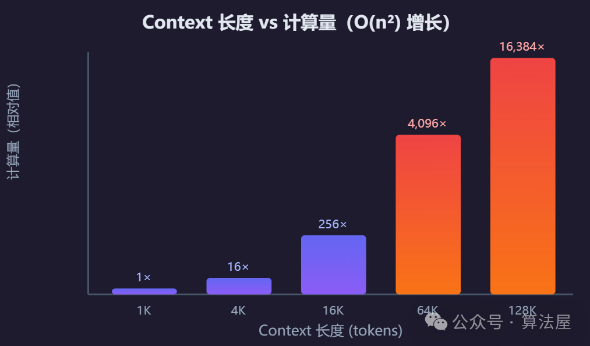
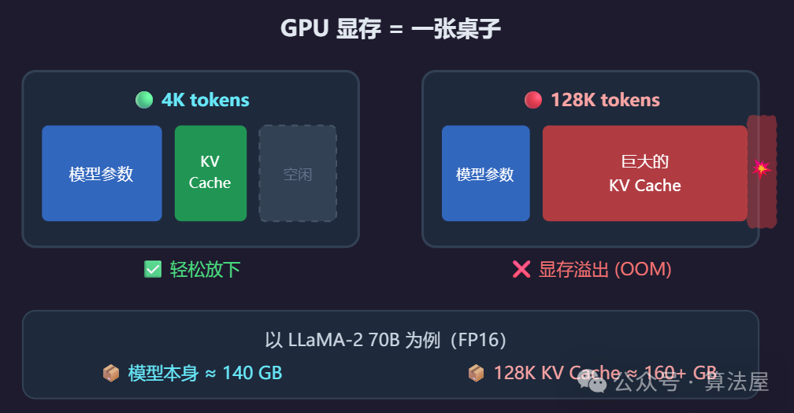
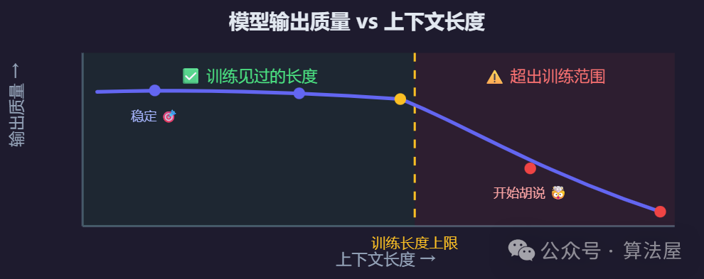
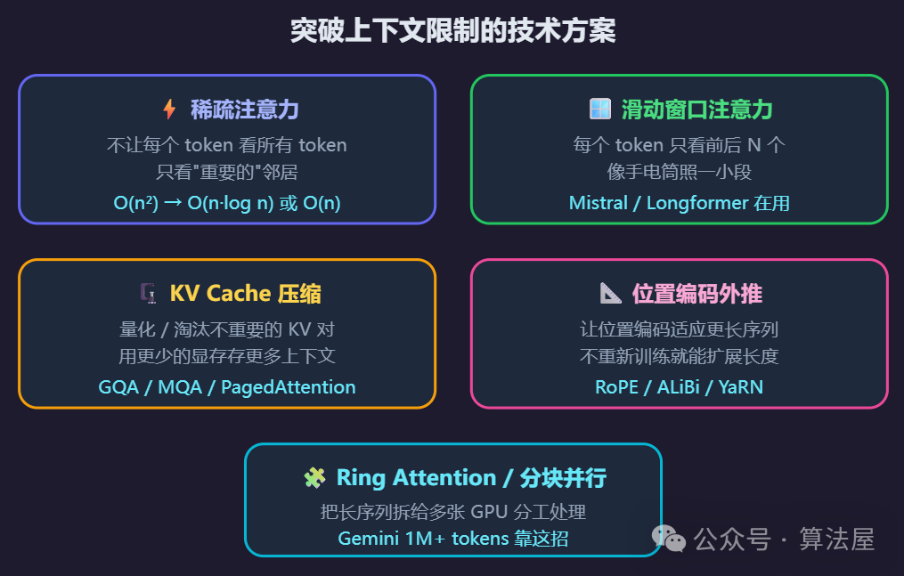

# 大模型上下文窗口为什么有限？这3个问题必须搞清楚

**上下文窗口（Context Window）** = 大模型一次能"看到"的最大文本量。

比如 GPT-4 的上下文窗口是 128K tokens，大约相当于一本 300 页的书。

那为什么不能做成无限大呢？核心就是 **三个问题**。

## 问题一：注意力的「平方爆炸」

### 什么是自注意力？

Transformer 的核心机制叫 **自注意力（Self-Attention）**——每个 token 都要和其他所有 token "对视"一次，判断彼此的关联。

> 🍎 **类比**：一个教室里，老师让每个学生和其他所有人握一次手。
>
> - 5 个学生 → 5 × 5 = **25 次**握手
> - 50 个学生 → 50 × 50 = **2,500 次**握手
>
> 人数涨了 10 倍，握手次数涨了 **100 倍**！

### 计算量怎么增长的？

| Token 数量 | 注意力计算次数 | 直觉感受 |
| --- | --- | --- |
| 1,000 | 1,000,000 | 数一堆沙子 🏖️ |
| 10,000 | 100,000,000 | 数一片沙滩 🏖️🏖️ |
| 100,000 | 10,000,000,000 | 数一整片沙漠 🏜️ |
| 1,000,000 | 1,000,000,000,000 | 数整个撒哈拉 🌍 |

> 上下文长 10 倍 → 计算量大 **100 倍**，不是 10 倍。这就是 \*\*O(n²)\*\*。

## 问题二：KV Cache 吃光显存

### 什么是 KV Cache？

模型在生成每个新 token 时，需要"记住"之前所有 token 的中间结果。这些中间结果以 **Key-Value 对** 的形式存在 GPU 显存里，叫做 **KV Cache**。

> 🍎 **类比**：你在写作文，桌上要摊开之前写过的所有草稿纸来参考。
>
> - 写了 1 页？桌子绰绰有余。
> - 写了 100 页？桌子已经堆满了。
> - 写了 1000 页？桌子根本放不下，纸掉地上了。

### 实际数字

| 模型 | 上下文长度 | KV Cache 大小 | 需要几张 A100 (80GB)？ |
| --- | --- | --- | --- |
| LLaMA-2 70B | 4K | ~5 GB | 2 张够了 |
| LLaMA-2 70B | 32K | ~40 GB | 需要 3-4 张 |
| LLaMA-2 70B | 128K | ~160 GB | 需要 4-6 张 |

> 💡 上下文越长，GPU 显存里要缓存的东西越多，多到装不下就 OOM 崩溃。

## 问题三：训练数据的「舒适区」

### 模型只见过有限长度的文本

训练时，模型看到的文本都有一个长度上限。推理时给它一个远超训练长度的上下文，它就会……**懵**。

> 🍎 **类比**：一个学生只做过 100 以内的加法题，你突然让他做 10000 以内的——他不是不会加法，而是从没练过那么大的数。

### 超长上下文时会怎样？

- **位置编码失效** —— 模型靠位置编码知道"第几个字"，超出范围后位置感知混乱
- **中间遗忘** —— 中间部分的内容容易被忽略（著名的 **Lost in the Middle** 问题）
- **重复 / 矛盾** —— 输出开始自我重复或前后矛盾

## 怎么解决这三个问题？

| 技术 | 解决的问题 | 核心思路 | 代表方法 |
| --- | --- | --- | --- |
| **稀疏注意力** | 计算量 O(n²) | 不看所有 token，只看重要的 | BigBird, Flash Attention |
| **滑动窗口** | 计算量 O(n²) | 每个 token 只看前后 N 个邻居 | Mistral, Longformer |
| **KV Cache 压缩** | 显存爆炸 | 量化 / 淘汰不重要的 KV 对 | GQA, MQA, PagedAttention |
| **位置编码外推** | 训练长度限制 | 让位置编码泛化到更长序列 | RoPE, ALiBi, YaRN |
| **序列并行** | 计算量 + 显存 | 长序列拆给多张 GPU 分工 | Ring Attention (Gemini 1M+) |

## 总结

| 限制因素 | 一句话理解 | 后果 |
| --- | --- | --- |
| **注意力 O(n²)** | 人多了握手次数爆炸 | 推理速度暴降、成本飙升 |
| **KV Cache** | 桌子太小纸太多 | GPU 显存 OOM 崩溃 |
| **训练长度** | 没做过大数加法 | 超出范围后输出质量变差 |

不是不想给你无限上下文，而是 **算力、显存、训练数据** 三个维度都不答应。这就是为什么即使硬件在进步，上下文窗口也只能渐进式扩展。
