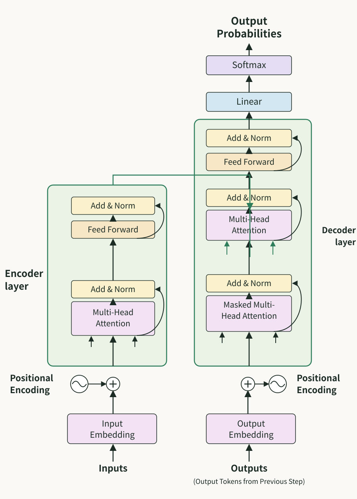
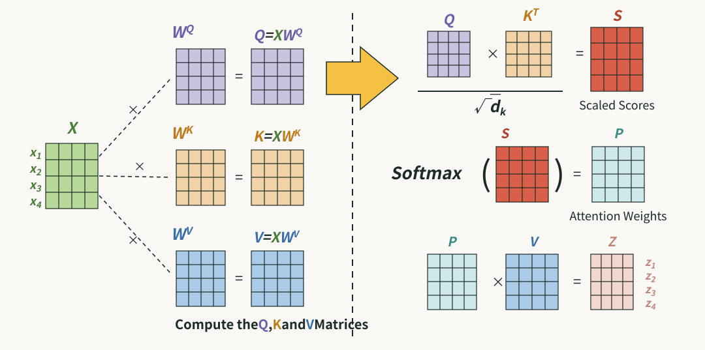
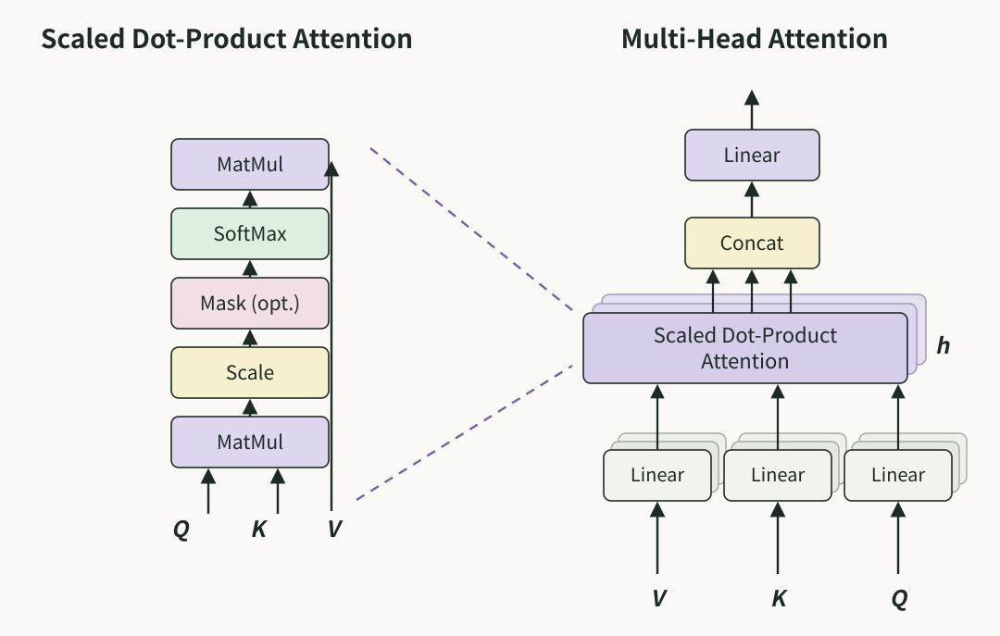
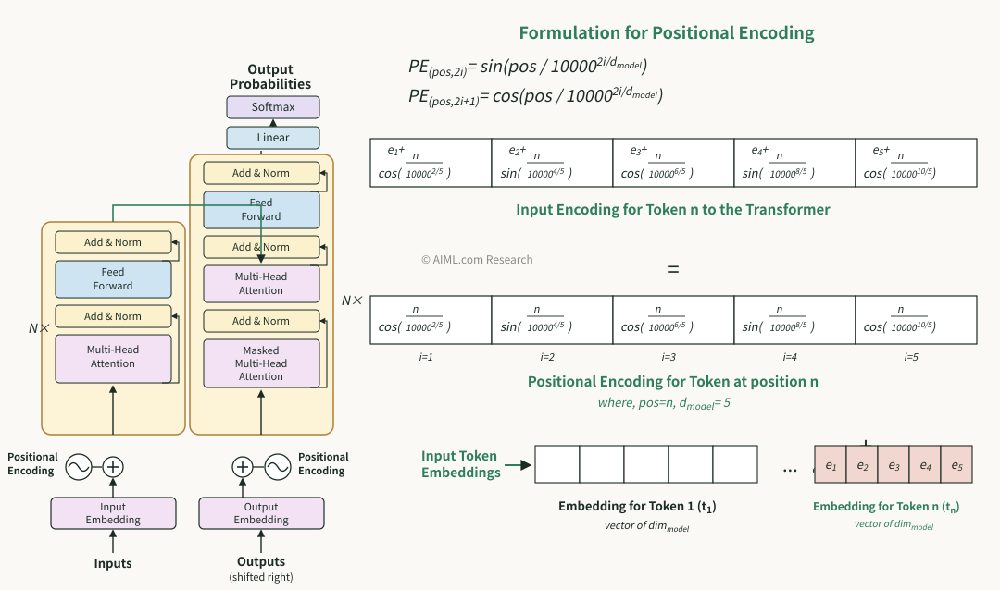
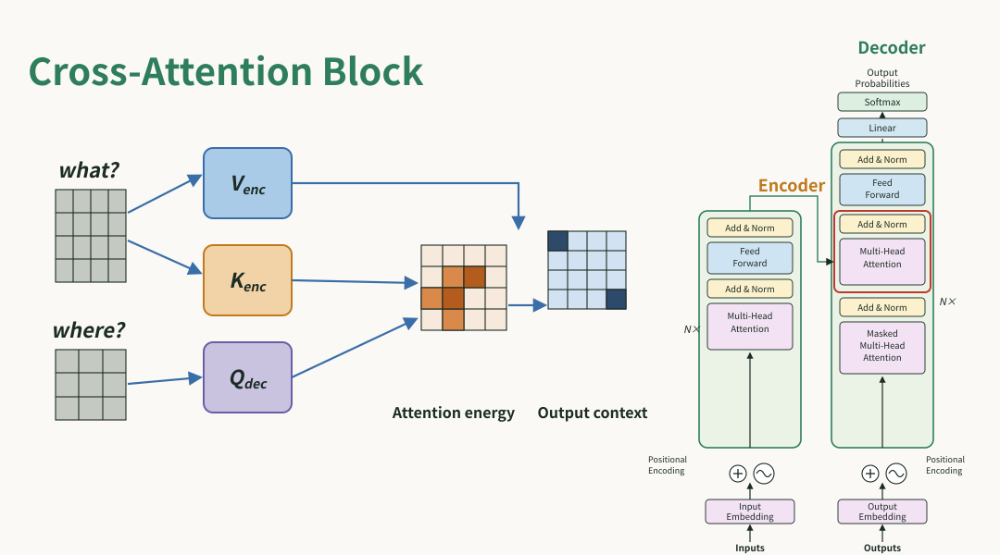

# 终于把 Transformer 算法搞懂了！！

大家好，我是小寒

今天给大家分享一个超强的算法模型，Transformer

Transformer 是由 Google 在 2017 年的论文《Attention Is All You Need》中提出的一种深度学习架构，它彻底改变了自然语言处理（NLP）领域，并成为当前大语言模型（如 GPT、Claude、Gemini）的的底层架构。

与之前的 RNN 和 LSTM 不同，Transformer 摒弃了递归结构，完全基于自注意力机制（Self-Attention）来捕捉序列中的全局依赖关系，使得模型能够并行处理序列数据，并捕捉长距离的依赖关系。



### 核心架构：编码器-解码器

Transformer 遵循典型的 Encoder-Decoder（编码器-解码器）结构。

- Encoder（编码器）

  负责将输入序列映射为高维的上下文表示。

  它由 $N$ 个相同的层堆叠而成，每层包含两个子层：多头自注意力机制（Multi-Head Self-Attention）和前馈神经网络（Feed-Forward Network）。
- Decoder（解码器）

  根据 Encoder 的输出和当前已生成的序列，自回归地生成目标序列。

  同样由 $N$ 个相同的层堆叠而成，每层包括三个子层：掩码多头自注意力（Masked Multi-Head Self-Attention）、编码器-解码器交叉注意力（Encoder-Decoder Attention）和前馈神经网络。

### 核心数学原理

#### 1.自注意力机制

这是 Transformer 的灵魂。它允许模型在处理一个词时，通过关注句子中所有其他词来获取上下文信息。



**计算过程**

给定输入矩阵 $X$，我们通过线性变换得到三个向量：Query ($Q$)**、**Key ($K$) 和 Value ($V$)。

$$Q = XW^Q, \quad K = XW^K, \quad V = XW^V$$

然后计算注意力分数

$$\mathrm{Attention}(Q, K, V) = \mathrm{softmax}\left(\frac{QK^T}{\sqrt{d_k}}\right)V$$

- \*$QK^T$\*：计算词与词之间的相关性得分。
- \*$\sqrt{d_k}$\*：缩放因子，除以 $\sqrt{d_k}$ 是为了防止点积数值过大导致 Softmax 进入梯度饱和区，引起梯度消失。
- Softmax：进行归一化，使得注意力权重和为 1。
- 最后乘以 $V$：根据权重加权求和，得到当前词的上下文表征。

#### 2.多头注意力机制

为了让模型从多个不同的子空间中学习信息，Transformer 采用多头注意力机制（例如，一个头关注语法关系，另一个关注指代关系）。



它将 $Q, K, V$ 分割成 $h$ 个头，每个头独立执行注意力计算，最后将结果拼接并线性投影

$$\mathrm{MultiHead}(Q, K, V) = \mathrm{Concat}(\mathrm{head}_1, \dots, \mathrm{head}_h)W^O$$

其中 $\mathrm{head}_i = \mathrm{Attention}(QW_i^Q, KW_i^K, VW_i^V)$

```
import torch  
import torch.nn as nn  
import torch.nn.functional as F  
import math  
  
class MultiHeadAttention(nn.Module):  
    def __init__(self, d_model, num_heads):  
        super(MultiHeadAttention, self).__init__()  
        assert d_model % num_heads == 0, "d_model 必须能被 num_heads 整除"  
          
        self.d_model = d_model  
        self.num_heads = num_heads  
        self.d_k = d_model // num_heads # 每个头的维度  
          
        # 线性映射层：将输入映射为 Q, K, V  
        self.W_q = nn.Linear(d_model, d_model)  
        self.W_k = nn.Linear(d_model, d_model)  
        self.W_v = nn.Linear(d_model, d_model)  
          
        # 最后的输出投影层  
        self.W_o = nn.Linear(d_model, d_model)  
          
    def scaled_dot_product_attention(self, Q, K, V, mask=None):  
        # Q, K, V shape: (batch_size, num_heads, seq_len, d_k)  
        attn_scores = torch.matmul(Q, K.transpose(-2, -1)) / math.sqrt(self.d_k)  
          
        if mask is not None:  
            # 填充 mask：将需要屏蔽的位置设为一个极小值，使其在 softmax 后趋近于 0  
            attn_scores = attn_scores.masked_fill(mask == 0, -1e9)  
              
        attn_probs = F.softmax(attn_scores, dim=-1)  
        output = torch.matmul(attn_probs, V)  
        return output, attn_probs  
  
    def forward(self, x, mask=None):  
        batch_size, seq_len, d_model = x.size()  
          
        # 1. 线性变换并分头  
        Q = self.W_q(x).view(batch_size, seq_len, self.num_heads, self.d_k).transpose(1, 2)  
        K = self.W_k(x).view(batch_size, seq_len, self.num_heads, self.d_k).transpose(1, 2)  
        V = self.W_v(x).view(batch_size, seq_len, self.num_heads, self.d_k).transpose(1, 2)  
          
        # 2. 计算多头注意力  
        attn_output, attn_probs = self.scaled_dot_product_attention(Q, K, V, mask)  
          
        # 3. 拼接（Concat）并将头维度合并回去  
        attn_output = attn_output.transpose(1, 2).contiguous().view(batch_size, seq_len, d_model)  
          
        # 4. 输出投影  
        return self.W_o(attn_output)  
  
## 使用示例  
d_model = 512  
num_heads = 8  
batch_size = 1  
seq_len = 10  
  
mha = MultiHeadAttention(d_model, num_heads)  
input_tensor = torch.randn(batch_size, seq_len, d_model)  
output = mha(input_tensor)  
  
print(f"输入形状: {input_tensor.shape}")  
print(f"输出形状: {output.shape}")
```

#### 3.位置编码

由于 Transformer 没有递归或卷积结构，它无法感知序列的顺序。

为了引入位置信息，我们在词嵌入（Embedding）中加入位置编码

- 对于偶数位置 $2i$：$PE_{(pos, 2i)} = \sin(pos / 10000^{2i/d_{model}})$
- 对于奇数位置 $2i + 1$：$PE_{(pos, 2i+1)} = \cos(pos / 10000^{2i/d_{model}})$

这种正弦/余弦函数编码允许模型通过相对距离轻松学习位置信息。



#### 4.前馈神经网络

在注意力层之后，使用一个两层的 MLP 进行逐位置映射

$$\mathrm{FFN}(x) = \max(0, xW_1 + b_1)W_2 + b_2$$

#### 5.残差连接与层归一化

每个子层后面都添加了残差连接和层归一化，以缓解深层网络中的梯度消失问题。

$$\mathrm{Output} = \mathrm{LayerNorm}(x + \mathrm{Sublayer}(x))$$

#### 6.掩码多头自注意力

该组件位于 Decoder 的最底层。

它的核心目标是：在生成过程中，防止当前位置看到未来位置的信息，从而强制模型以自回归的方式逐步生成输出。

其计算过程与普通的自注意力一致，但在计算 Softmax 之前，增加了一个因果掩码。

$$\mathrm{Attention}(Q, K, V) = \mathrm{softmax}\left(\frac{QK^T}{\sqrt{d_k}} + M\right)V$$

其中 $M$ 是一个下三角掩码矩阵

$$M_{ij} = \begin{cases} 0, & \text{if } i \geq j \\ -\infty, & \text{if } i < j \end{cases}$$

通过在 Softmax 之前加上这个下三角矩阵 $M$，当计算第 $i$ 个词的注意力时，所有 $j > i$（未来位置）的得分会被加上 $-\infty$，经过 Softmax 后归一化为 0，从而确保模型在推理时严格遵循“因果性”。

#### 7.编码器-解码器交叉注意力

这是连接 Decoder 与 Encoder 的桥梁。它的作用是让 Decoder 在生成每一个 Token 时，都能够“回看” 原始输入序列（Encoder 的输出）。

其计算公式为：

$$\mathrm{Cross\text{-}Attention}(Q_{dec}, K_{enc}, V_{enc}) = \mathrm{softmax}\left(\frac{Q_{dec}K_{enc}^T}{\sqrt{d_k}}\right)V_{enc}$$

其中

- $Q_{dec}$：来自 Decoder 的上一层输出。它代表“当前我正在关注生成任务的哪个部分”。
- $K_{enc}$  和 $V_{enc}$：来自 Encoder 的最终输出。它们代表“原始输入序列中包含的丰富语义信息”。



### Transformer 的关键优势

1. 并行计算能力：RNN 必须按时间步递归计算，而 Transformer 可以对整个序列进行并行计算，大幅提升了训练效率。
2. 长距离依赖捕捉：在 RNN 中，距离越远的词信息损失越严重；而 Transformer 中，任意两个词的路径长度均为 $O(1)$，信息流动更加顺畅。
