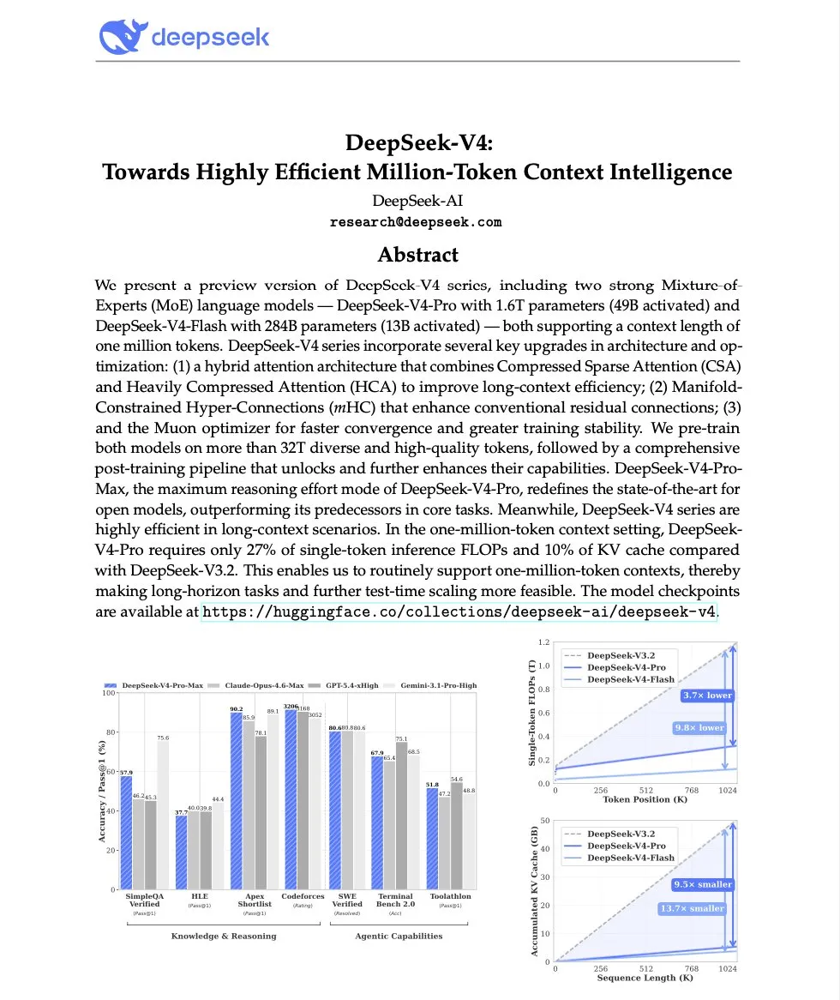
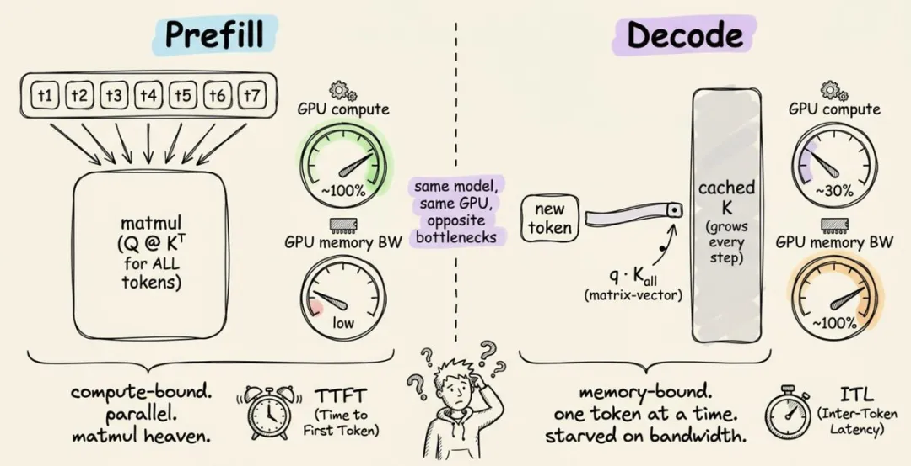
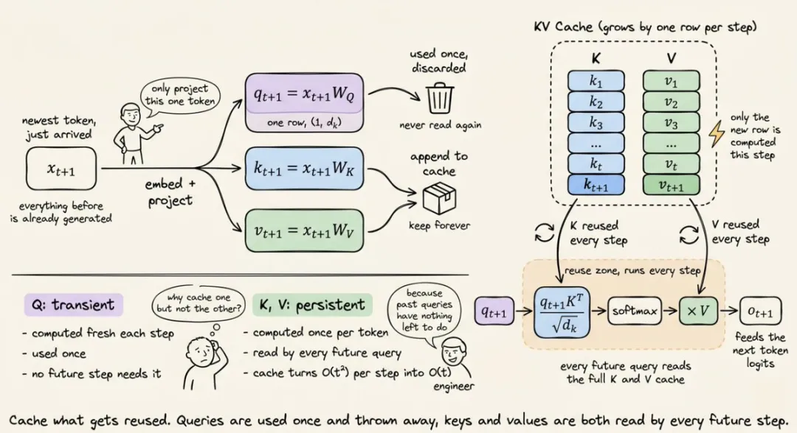
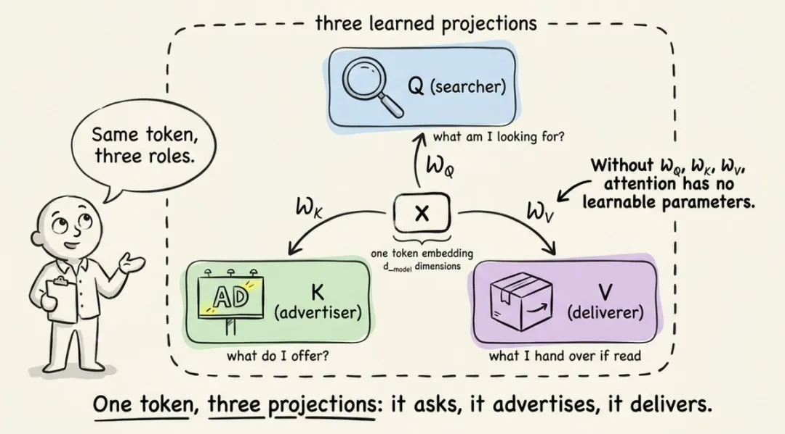
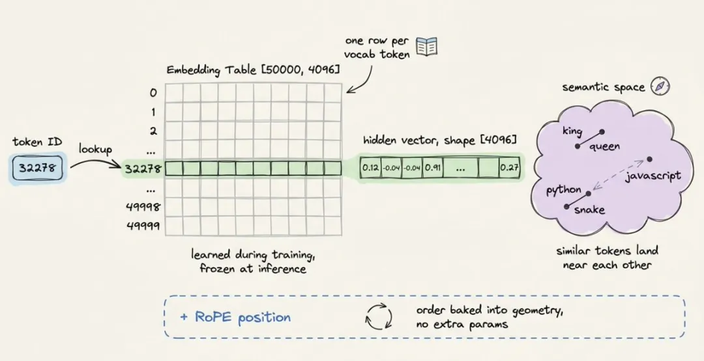
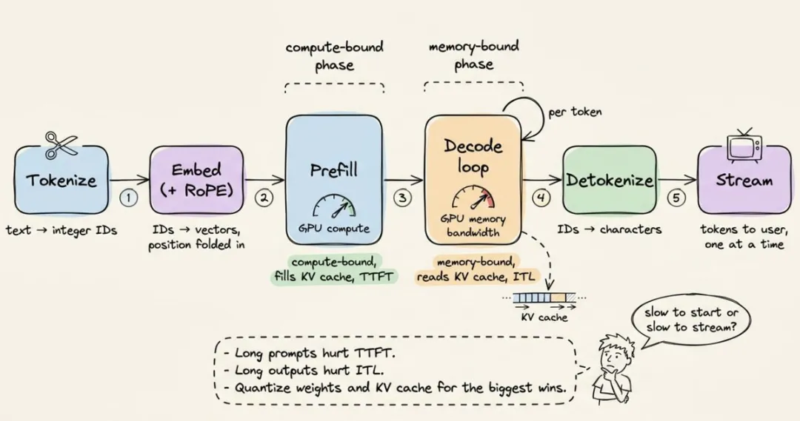
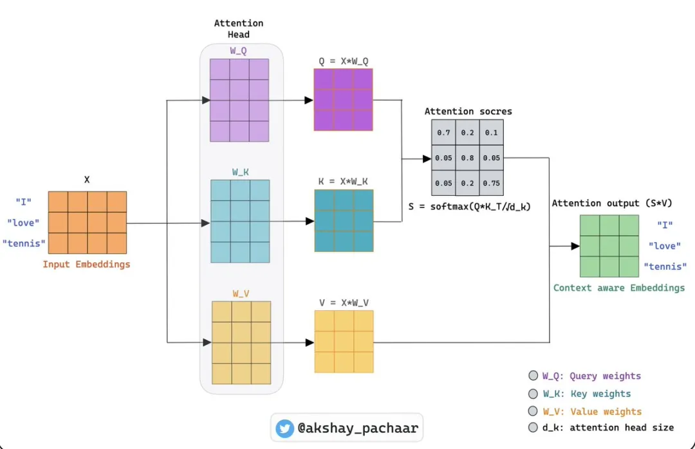

# LLM 推理为什么先慢后快？从 Prefill、Decode 到 KV Cache 讲清楚

LLM 推理的延迟不能只用“快”或“慢”概括。

一次回答里至少有两个阶段：**Prefill** 和 **Decode**。Prefill 负责处理完整 prompt，并生成第一个输出 token；Decode 负责在第一个 token 之后，继续一个 token 一个 token 地生成内容。

这两个阶段的瓶颈不一样。Prefill 主要吃 GPU 算力，决定用户等多久才能看到第一段文字；Decode 主要吃显存带宽和 KV Cache，决定文字流出来的间隔有多短。

所以，优化 LLM 应用前，先问清楚延迟发生在哪里。

是首 token 出得慢，用户提交问题后一直空等？还是首 token 已经出来，但后续文字像挤牙膏？这两种慢对应不同系统瓶颈，也对应不同优化手段。

Akshay Pachaar 把 LLM inference 的链路讲得比较完整：tokenizer、embedding、attention、prefill、decode、KV cache、quantization 都串在了一起。下面按工程视角重新梳理一遍。



*这张图把推理延迟拆成两块：Prefill 是 compute-bound，Decode 是 memory-bound。第一 token 慢、后面 token 一粒一粒出来，原因就在这里。*

## LLM 为什么只能一个 token 一个 token 写？

LLM 不是一次性写完整段答案。

模型每一步只做一件事：根据当前上下文预测下一个 token。预测出来以后，这个 token 会被接回上下文，模型再继续预测下一个 token。循环不断重复，直到生成结束。

一次生成可以简化成下面这个过程：

```
输入 prompt  
    ↓  
预测第 1 个 token  
    ↓  
把第 1 个 token 接回上下文  
    ↓  
预测第 2 个 token  
    ↓  
不断重复
```

理解 LLM 推理，关键不是想象模型如何“一次写出答案”，而是看清楚每一步如何预测下一个 token，以及第一个 token 和后续 token 为什么走的是两种性能路径。

## Tokenizer 决定模型实际处理多少内容

神经网络不直接读取中文或英文。

模型看到的是数字。用户输入的文本会先经过 tokenizer，被切成一串 token，每个 token 对应一个整数 ID。

现代 LLM 常用 Byte Pair Encoding 一类方法。它会把高频片段合并成词表里的 token。常见词可能一个 token 就能表示，少见词会被拆成多个片段。



Tokenizer 会影响成本，也会影响延迟。

如果某种语言或领域词在 tokenizer 训练数据里覆盖不足，同样一句话可能被切成更多 token。token 越多，模型要处理的位置越多，首 token 等待时间也会变长。

这也是为什么“字符数差不多”的两段输入，在模型服务里成本可能不一样。模型计费和推理负载看的是 token，不是字符数。

## Embedding 把 token ID 变成语义向量

token ID 只是编号，还不能直接参与神经网络计算。

模型会用 embedding table 把每个 token ID 映射成一个向量。假设词表大小是 50K，hidden dimension 是 4096，那么 embedding table 的形状就是 `[50000, 4096]`。输入一个 token ID，实际就是去表里取一行向量。



这些向量会在训练过程中学到语义关系。

语义相近的 token 会被推到相近位置。比如 `king` 和 `queen` 会比较接近，`python` 既可能靠近 `snake`，也可能在另一个语义方向上靠近 `javascript`。

模型还需要知道顺序。Attention 本身不知道哪个 token 在前、哪个 token 在后，所以现代模型会用 RoPE 这类位置编码方法，让向量携带位置信息。

## Attention 让每个 token 带着上下文判断

向量进入 transformer 层后，主要计算开始。

一个 LLM 往往有几十层 transformer。每一层大致做两类计算：self-attention 混合不同 token 之间的信息，feed-forward network 处理每个 token 自己的信息。

Self-attention 的关键是 Q、K、V。

每个 token 的向量会分别乘上三组权重矩阵，得到三个新向量：

- Query：我现在要找什么信息
- Key：我这里有什么信息可供匹配
- Value：如果别人需要我，我能贡献什么内容



Attention 的计算可以这样理解：**每个 token 用自己的 Query 去匹配所有 token 的 Key，再按匹配强度混入对应的 Value。**

这个机制让 token 不再孤立。代词可以回看前面的人名，技术名词可以吸收上下文定义，长句后半段也可以引用前半段的信息。



Attention 负责搬运上下文，feed-forward network 负责继续加工每个位置的表示。几十层堆叠以后，模型就能在长上下文里追踪引用、关系和语义依赖。

## 第一个 token 为什么要等？

经过最后一层 transformer 后，模型会取最后一个位置的向量，把它投影回词表大小。

如果词表有 50K 个 token，模型就会得到 50K 个分数。经过 softmax 后，这些分数变成概率分布。采样或取最大概率以后，下一个 token 才会出来。

这一步听起来只是“预测一个词”，前面却要先完成整段 prompt 的计算。

当 prompt 有 2000 个 token 时，每一层 transformer 都要处理这 2000 个 token。好消息是，Prefill 阶段可以并行；所有 token 的 Q、K、V 可以一起算，attention 也可以通过大矩阵乘法完成。

GPU 很擅长这种工作负载。大矩阵乘大矩阵，正是 GPU 的强项。

Prefill 的瓶颈主要是算力，也就是 compute-bound。它决定的指标叫 **TTFT**，Time To First Token，也就是用户提交问题后，第一段文字多久才开始出现。

长 prompt 会显著增加 TTFT，因为模型必须先把所有输入 token 处理完，才有资格生成第一个输出 token。

## 后续 token 为什么一粒一粒出来？

第一个 token 出来以后，模型进入 Decode 阶段。

Decode 和 Prefill 的工作负载完全不同。生成第 51 个 token 时，前 50 个 token 的 Key 和 Value 已经算过，而且不会再变化。模型只需要为新 token 计算新的 Q、K、V，然后让新 token 去看前面缓存好的 K、V。

这个阶段计算量看起来变小了，瓶颈却转向显存读写。

每生成一个 token，GPU 都要加载模型权重，还要读取已有的 KV Cache。计算本身不大，但数据搬运很多。GPU 算力可能空着，延迟卡在内存带宽。

Decode 决定的指标叫 **ITL**，Inter-Token Latency，也就是相邻两个输出 token 之间隔多久。

这就是 Prefill 和 Decode 的关键差异：Prefill 是 compute-bound，Decode 是 memory-bound。同一个模型、同一张 GPU、同一次请求，前后两个阶段的优化方向完全不同。

## KV Cache 用显存换时间

KV Cache 解决的是重复计算。

如果没有 KV Cache，模型每生成一个新 token，都要重新计算整个上下文的 attention。生成越长，重复计算越多，复杂度会迅速变差。

有了 KV Cache，模型会把每一层、每个历史 token 的 Key 和 Value 存下来。下一步 decode 时，模型直接复用这些缓存，只为新 token 计算增量。

收益很直接：长生成场景里，速度可以提升数倍。

代价也同样直接：KV Cache 吃显存，而且会随 token 数线性增长。原文里给了一个估算：对 13B 模型来说，KV Cache 可能接近每 token 1MB。4K 上下文光缓存就可能占掉约 4GB 显存。

长上下文慢，不只是模型“想得更多”。更准确地说，是缓存变大了，显存压力和带宽压力都在变大。

常见优化包括：

- 把 KV Cache 量化到 INT8 或 INT4
- 使用 sliding window，丢掉窗口外的 token
- 用 grouped-query attention 让多个 attention head 共享 K、V
- 像 vLLM 的 PagedAttention 那样，把 KV Cache 当成操作系统内存分页管理

这些优化看起来底层，却直接决定长上下文模型能不能稳定服务用户请求。

## DeepSeek-V4 的例子：长上下文开始围绕缓存设计

原文特别提到 DeepSeek-V4，因为它把长上下文推理的瓶颈讲得更直观。

根据原文引用的技术报告，DeepSeek-V4-Pro 在 100 万 token 上下文下，相比前代模型，单 token 推理 FLOPs 约为 27%，KV Cache 约为 10%。


这类工作的意义不只是“又一个新模型发布了”。

更值得关注的是，模型架构开始围绕 KV Cache 做设计。过去大家更多讨论参数规模、benchmark 分数、上下文窗口长度；到了长上下文服务阶段，缓存成本能不能付得起，已经变成模型能否落地的关键约束。

当 attention 结构开始为了减少 KV Cache 改造时，推理瓶颈已经从“能不能支持长上下文”转向“能不能高效服务长上下文”。

## Quantization 减少的是权重搬运成本

训练需要较高精度，推理不一定需要。

生产环境里，很多模型不会用 FP32 跑推理，而是用 FP16 或 BF16。这样可以直接把权重显存占用减半，并利用 Tensor Core 提高吞吐。

更激进的方案会把权重量化到 INT8，甚至 INT4。

原文给了一个 7B 模型的直观数字：

| 精度 | 7B 模型权重大小 |
| --- | --- |
| FP32 | 28 GB |
| FP16 | 14 GB |
| INT8 | 7 GB |
| INT4 | 3.5 GB |

INT4 能让 7B 模型跑在笔记本 GPU 上，原因就在这里。

当然，量化不是免费午餐。位宽越低，信息损失越大。GPTQ、AWQ 这类方法会为不同通道选择缩放因子，尽量把质量损失压低。做得好时，INT4 在很多 benchmark 上只会损失很小一部分效果。

工程上，量化通常是杠杆很高的优化项。它同时降低权重加载成本、显存占用和服务延迟。

## 推理框架优化的是调度、缓存和内存布局

理解 Prefill、Decode 和 KV Cache 后，再看 vLLM、TensorRT-LLM、Text Generation Inference 这些服务框架，就更容易理解它们在做什么。

它们不是简单把 `generate()` 包成 API。

这些框架主要优化三类问题：

- **Continuous batching**

  ：把多个用户的 token 生成步骤交错到同一张 GPU 上，提高利用率
- **Speculative decoding**

  ：用小模型先草拟 token，再让大模型验证，减少等待
- **KV Cache 管理**

  ：更高效地分配、复用和分页缓存，避免显存碎片和浪费

单个用户看到的是流式输出，服务端看到的是一堆请求在同一张 GPU 上抢算力、抢显存、抢内存带宽。

高性能推理服务的难点，不只是模型结构，而是调度、缓存和内存布局。

## 定位慢，要先拆 TTFT 和 ITL

理解 LLM inference 后，优化方向会清楚很多。

长 prompt 主要影响 TTFT。

用户第一次等得久，通常和输入 token 多、检索上下文太长、系统提示词臃肿有关。优化方向是减少 prompt 长度、精简 RAG 上下文、缓存可复用前缀。

长输出主要影响 ITL。

如果首 token 很快，但后续输出慢，瓶颈更可能出在 decode 阶段。优化方向是更好的 KV Cache 管理、更高内存带宽、更激进的量化，或者使用 speculative decoding。

上下文长度也不是免费的。

把上下文从 32K 拉到 128K，不只是多算几倍 token。KV Cache 会变大，batch size 会被挤压，并发能力会下降。

GPU 利用率也可能误导判断。

Prefill 时 GPU 可能很忙，Decode 时 GPU 算力利用率可能不高，但显存带宽已经卡住。这个时候加更多算力不一定有效，减少缓存和改善内存访问才更重要。

遇到“模型很慢”时，先把问题拆成两类：

**它是慢在开始，还是慢在输出？**

这个拆法能直接决定优化方向。

## 结尾：把延迟拆开，优化才会落到工程上

Transformer 架构很重要，但线上推理性能经常卡在更具体的环节。

Tokenizer 会影响输入长度，Prefill 会影响首 token，Decode 会受显存带宽限制，KV Cache 会吃掉上下文扩展的红利，Quantization 会改变模型能不能装进显存。

落到工程上，不要只问“模型为什么慢”。这个问法太粗。

更好的排查顺序是：

1. 输入 token 是不是太多？
2. TTFT 是不是太高？
3. ITL 是不是太长？
4. KV Cache 是不是挤压了显存和并发？
5. 权重或缓存有没有量化空间？
6. serving 框架有没有做好 batching、分页和调度？

把这些问题拆开，LLM 推理优化才会从玄学变成工程。

Akshay Pachaar, **How LLM Inference Works**  
https://x.com/akshay\_pachaar/status/2050941458614751327
