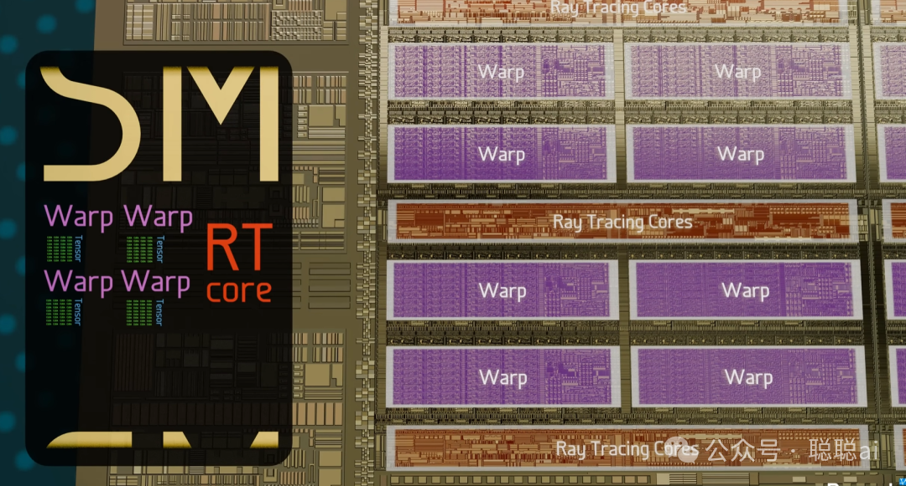

# 万字长文｜彻底理解 GPU 架构与深度学习加速原理

2012 年，AlexNet 在 ImageNet 竞赛中以压倒性优势夺冠，深度学习时代正式开启。不到两年后的 2014 年，NVIDIA 发布了 Maxwell 架构 GPU，将游戏画质推向了新高度。

但真正改变历史的，是 2006 年 CUDA 架构的诞生——那一年，NVIDIA 播下了一颗种子，让 GPU 从一块"游戏显卡"变成了"通用算力引擎"，最终催生了今天的大模型革命。

这篇文章，我想带你从最底层出发，系统理解 GPU 到底是怎么工作的，以及它为什么能成为 AI 时代最重要的基础设施。

> 📺 **推荐配套视频：How do Graphics Cards Work?** — Branch Education 出品
>
> 推荐Branch Education 的科普视频，这支 GPU 视频延续了其一贯风格：从晶体管级别出发，逐层拆解 GA102 芯片的物理架构、CUDA 编程模型、Tensor Core 和 RT Core 的分工。即使你已经看过大量 GPU 文章，这支视频依然能给你"原来如此"的顿悟感。本文正是以这支视频为骨架，结合 CUDA 编程实践、Tensor Core 五代演进、深度学习训练/推理的系统性知识扩充而成。

## 一、CPU 和 GPU：两个物种，不是两个版本

很多人一开始学 GPU，都会有一个困惑：CPU 和 GPU 到底有什么区别？是不是 GPU 更快？更强？

答案是：它们不是强弱之分，是**设计哲学的根本分歧**。

**CPU 的设计目标：低延迟（Low Latency）**

当你点开一个应用、切换一个窗口，CPU 需要在最短时间内给你响应。所以 CPU 把大量晶体管投入在：

- **分支预测（Branch Prediction）**

  ：提前猜测代码往哪走，减少空转
- **乱序执行（Out-of-Order Execution）**

  ：不等上一条指令完全执行完，就先执行后面独立的指令
- **大容量缓存**

  ：用高速缓存吸收内存延迟，不用每次都去"图书馆"（内存）找数据

CPU 的逻辑是：**让单个线程跑得尽可能快**。

**GPU 的设计目标：高吞吐（High Throughput）**

游戏里每一帧画面，需要同时计算数百万个像素；大模型里，一个矩阵乘法有几十亿次运算——这些任务有一个共同特点：**海量相同类型的计算，彼此独立**。

GPU 的策略是：**不追求单个线程快，而是让海量的线程同时跑**。

这就解释了为什么 RTX 3090 有 10,752 个 CUDA Core，而一块高端服务器 CPU 最多也就 64 个核心——不是技术高低，是设计目标不同。

> 类比：CPU 像一架 Jumbo Jet，载客量少但飞得快；GPU 像一艘巨型货轮，装载量巨大但单体速度慢。问"哪个更快"没有意义，取决于你要运输什么。

> **图 1：GPU 与 CPU 的晶体管分配对比**（来源：NVIDIA CUDA 编程指南）— 左为 CPU：大量晶体管用于缓存和控制电路；右为 GPU：大多数晶体管用于数据处理（算术逻辑单元）

### 延迟掩盖：GPU 的核心生存智慧

GPU 的计算单元速度极快，但访问显存（Global Memory）的延迟高达数百个时钟周期——这相当于每次计算都要等几分钟的图书馆调书。

GPU 的解法是：**当一个 warp（32 个线程）在等数据时，SM 立刻切换到另一个 warp 来执行计算**。GPU 的实际性能，取决于**并行度是否足够高**，能持续喂饱计算单元。

这就是所谓的 **Latency Hiding（延迟掩盖）**——GPU 不消除延迟，而是用高并行度把延迟"埋"起来。

## 二、CUDA 编程模型：为什么 GPU 需要自己的编程语言

### 问题的起源：GPU 最初根本不是用来"编程"的

2006 年之前，GPU 的唯一任务就是画图。渲染一张游戏画面，底层发生的事情是：CPU 把顶点坐标、纹理、光照参数等数据交给 GPU，GPU 内部有一条**固定的硬件流水线**逐级处理，最终输出像素颜色。

```
顶点数据 → 顶点着色器 → 图元装配 → 光栅化 → 片段着色器 → 帧缓冲
```

这条流水线的每一级都是**专用硬件**——你不能改变它们的连接方式，不能让顶点着色器去做矩阵乘法。这就是为什么用 GPU 做通用计算（Scientific Computing、金融分析、AI 训练）几乎不可能：你需要用图形 API（OpenGL/DirectX）"伪装"你的计算任务，把数据塞进纹理、把计算伪装成着色器——极其繁琐，且性能损失严重。

### CUDA 的诞生：一个大胆的问题

2007 年，NVIDIA 问了自己一个反直觉的问题：**为什么 GPU 的计算单元只能做图形？为什么不能直接命令它们做任意数学运算？**

这个问题的答案就是 CUDA（Compute Unified Device Architecture）。

CUDA 的核心创新不是发明了新硬件，而是**发明了一套编程模型**：让开发者用 C/C++ 的语法，直接控制 GPU 上成千上万个计算单元并行执行。

> 这和当年为什么会有 Java 一样——不是为了造新硬件，而是为了给现有的硬件提供更好的抽象。CUDA 对 GPU 的意义，相当于 Java 对 JVM 的意义：一次编写，到处运行（只不过这里是一次编写，万核并行）。

### 为什么要分三层：Grid → Block → Thread

这是 CUDA 设计里最精妙的地方。

你写了一段代码，要在 GPU 上跑矩阵加法：把两个矩阵对应位置加起来，结果写到第三个矩阵。

数学上，这个问题天然是**并行的**——每个位置的加法完全独立，互不依赖。那你作为程序员，你面临的问题是：**我怎么把我这个"数学问题"翻译成 GPU 能理解的任务分配？**

CUDA 给了你三个层次的抽象：

**Thread（线程）：** 最底层的执行单元。一个 Thread 负责计算结果矩阵 C 中的一个元素 `C[i] = A[i] + B[i]`。物理上，一个 Thread 就是 SM（流式多处理器）上调度和执行的一条指令流。

**Block（线程块）：** 一组 Thread（最多 1024 个）的物理分组。**同一个 Block 里的所有 Thread，物理上运行在同一个 SM 上**，因此它们可以通过 SM 上的 Shared Memory 互相通信、互相等待（同步）。不同 Block 之间无法直接通信——因为它们的物理位置（SM）事先未知，硬件无法保证它们在同一个地方。

**Grid（网格）：** 所有 Block 的集合，覆盖整个 GPU。一个 Grid 就是一个完整的计算任务。

为什么 Block 要限制在 1024 个 Thread？  
 - 一个 SM 上的寄存器数量是固定的（每个 SM 约 256 KB 的 Register File）  
 - 一个 SM 同时最多容纳 64 个 Warp（每个 Warp 32 Threads = 2048 Threads/SM 物理上限）  
 - 但每个 Thread 需要自己的寄存器，1024 Threads/block × N registers/thread，很快就会把寄存器用光  
 - 1024 是一个经验值：在大多数 workload 下，这个上限既能保证足够并行，又不会让寄存器溢出

> **图 3：CUDA Grid of Thread Blocks**（来源：NVIDIA CUDA 编程指南）— Grid 由多个 Thread Block 组成，每个 Block 在一个 SM 上执行，Block 内的 threads 可通过 shared memory 通信

### Warp：32 个线程为何绑在一起

**Warp 是硬件真正调度指令的最小单位。**  


CUDA 编程模型里你写的是 Thread，但硬件 SM 实际上**一次调度 32 个 Thread 同时执行同一条指令**。这 32 个 Thread 就构成一个 Warp（字面意思：一束）。

为什么要 32？  
 - 这是一个硬件决定的数字，源于 GPU 内存总线宽度和并行度的平衡  
 - GPU 的全局内存访问以 **128 字节（32×4 字节）为单位**，恰好一个 Warp 的所有线程访问连续内存时，一次内存事务就能满足所有 32 个线程的数据需求  
 - 如果 Warp 大小不是 32，内存合并的效率就会降低

这就是为什么：**同一个 Warp 内的所有线程，永远执行完全相同的指令**（SIMT 的 S——Single Instruction）。如果它们执行路径分叉了（if/else），就会产生 Warp Divergence：GPU 不得不把分支的两个路径都跑一遍，让不需要的线程空转。

这也告诉我们：**分支越少、线程行为越一致，GPU 利用率越高**。

> 一个有趣的类比：Warp 就像划船比赛时的一排桨手。32 个人必须同时划——如果有人划、有人不划，整条船的速度反而会互相抵消。只有所有桨手节奏一致，效率才最高。

### CUDA 内存模型：速度与距离的关系

CUDA 把内存分成了清晰的层次，每个线程能访问的存储位置决定了速度：

> **图 4：CUDA 内存层次**（来源：NVIDIA CUDA 编程指南）— 寄存器→Local Memory→Shared Memory→L2 Cache→Global Memory→Host Memory，带宽递减、延迟递增

这张图值得反复琢磨：**离计算单元越近，速度越快，但容量越小**。这也是为什么 GPU 程序要尽量把数据"预取"到 Shared Memory，避免频繁访问显存——Global Memory 的带宽只有 L1 的千分之一，延迟是 L1 的 300 倍。

### Occupancy（占用率）：GPU 性能的核心指标

Occupancy = **活跃 Warp 数 / SM 支持的最大 Warp 数**。

如果 Occupancy 很低，意味着很多 Warp 在等内存，计算单元闲置。导致低 Occupancy 的常见原因：

1. **寄存器溢出**

   ：每个线程用太多寄存器，溢出到本地内存
2. **Shared Memory 分配过多**

   ：一个 SM 只有 128 KB Shared Memory
3. **Block size 设置太小**

   ：硬件无法调度足够的 Warp

NVIDIA 提供 **Occupancy Calculator** 工具，可以帮助开发者计算最优配置。

### 矩阵乘法：理解 Shared Memory 价值的最好例子

为什么 Shared Memory 这么重要？我们用一个矩阵乘法的例子来理解。

**无 Shared Memory 的做法**：每个线程计算 C 矩阵的一个元素，需要从显存里反复读取 A 矩阵的一整行和 B 矩阵的一整列——大量的重复读取，性能极差。

**使用 Shared Memory 的做法**：先把 A 矩阵的一块瓦片（Tile）从显存一次性加载到 Shared Memory，然后 Block 内的所有线程共享这块数据——"大家分着看一本书"，而不是每个人单独去图书馆借。

> **图 5-a：矩阵乘法（无 shared memory）**
>
> （来源：NVIDIA CUDA 编程指南）— 每个线程独立访问全局内存，大量冗余读取

> **图 5-b：矩阵乘法（使用 shared memory）**
>
> （来源：NVIDIA CUDA 编程指南）— 将 A 的行加载到 shared memory，显著减少全局内存访问次数

Flash Attention 之所以能极大加速 Transformer 的注意力计算，本质上就是一种极端的 Shared Memory 优化技术——把注意力矩阵的分块策略做到了极致。

## 三、GA102 物理架构：628 mm²，283 亿晶体管

RTX 3090 用的 GA102 芯片是一个工程奇迹。

**核心规格：**

| 参数 | GA102（RTX 3090） |
| --- | --- |
| 工艺 | Samsung 8nm |
| 晶体管数 | **283 亿** |
| Die 面积 | 628 mm² |
| GPC 数量 | 7 |
| CUDA Core 总数 | 10,752 |
| Tensor Core 总数 | 336 |
| Ray Tracing Core 总数 | 84 |
| L2 Cache | 6 MB |
| 显存 | 24 GB GDDR6X，384-bit |
| 显存带宽 | 936 GB/s |

**分层结构：**

### SM 内部结构：GPU 的基本作战单元

**SM（Streaming Multiprocessor，流式多处理器）是 GPU 的基本执行单元。** 理解 SM 为什么长这样，比记住它包含什么部件更重要。

#### SM 是怎么来的：为什么要"流式"处理

CPU 的执行模型是**指令流**：一条指令执行完，才执行下一条（加上流水线，超标量等优化，本质还是顺序推进）。

GPU 面对的工作负载（渲染像素、矩阵运算）和 CPU 完全不同：**数百万个任务，彼此完全独立，结果互不影响**。与其让一个复杂的处理器逐一处理，不如让 N 个简单的处理器**同时处理 N 个任务**。

这就是 SM 名称里"Stream"（流）的含义：**数据流进处理器，每个处理单元只管自己的那一段，处理完直接输出**——而不是等上一级完成。

用一个生活场景类比：  
 - CPU 像一条**流水线工厂**，每个工位做复杂装配，必须等上一个工位完成才能继续  
 - GPU 像**酒店自助餐台**，每个厨师同时做自己的菜，客人各取所需，不需要排队等一个人做完

#### SM 内部为什么这样设计

SM 内部的所有组件，都是为了解决同一个问题：**如何让海量简单计算并行执行，同时尽可能减少数据搬运的代价。**

**为什么需要 Warp Scheduler？** 当一个 Warp 在等内存数据（300 周期延迟），Warp Scheduler 立刻切换到另一个 Warp 执行，用计算掩盖等待。SM 上有 4 个 Warp Scheduler，意味着**同一个 SM 可以在 4 个 Warp 之间交替发射指令**，保持计算单元始终有活干。

**为什么 CUDA Core 是 32 个？** 一个 Warp = 32 个线程，SM 要在一个时钟周期内发射一条指令给这 32 个线程，所以需要 32 个执行单元来对应 32 个线程。这 32 个 CUDA Core 以 **SIMD（单指令多数据）** 的方式工作——同一条指令，同时作用在 32 个数据上。

**Tensor Core 为什么只有 1 个？** Tensor Core 的矩阵乘法运算是密集计算，单个 Tensor Core 的计算密度已经很高（每周期 512 FLOPs），增加数量会大幅增加功耗和面积。一个 SM 有一个 Tensor Core 已经是面积/性能/功耗的平衡结果。

**SFU 为什么只有 4 个？** 超越函数（sin、cos、log）在 GPU 代码里出现的频率远低于普通加减乘除，而且 SFU 每个周期只能处理一条指令——给太多是浪费，4 个是经验最优值。

每个 SM 每时钟周期可以调度 **4 个 Warp（共 128 个线程）** 同时发射指令。

> **为什么要 binning？** 一个 wafer 上的 die 质量不均匀，完美的 die → RTX 3090 Ti；轻微缺陷 → RTX 3090（屏蔽部分 SM）；缺陷更多 → RTX 3080。这是半导体商业化的核心策略，不是技术失败。

> **图 6：NVIDIA A2 Tensor Core GPU 产品照**（来源：NVIDIA 官方 Ampere 架构页面）— Ampere 架构入门级数据中心 GPU，单槽被动散热；注意：GA102/RTX 3090 的内部 die shot 目前暂无官方图，此图仅作 Ampere 架构产品形态参考

## 四、三类核心：CUDA Core、Tensor Core、RT Core

GA102 里有三类不同的运算核心，分工明确、各有所长。这是理解现代 GPU 架构最重要的一节。

### 4.1 CUDA Core：GPU 的"基本步兵"

CUDA Core 本质上就是一个**可以在一个时钟周期完成一次浮点乘加（FMA）操作的运算单元**：

```
D = A × B + C
```

乘法和加法在硬件里是**融合的**——同一个周期内完成，不需要中间舍入，精度更高，这就是 FMA（Fused Multiply Add）名称的由来。

**GA102 的 CUDA Core 分类：**

| 类型 | 数量/SM | 总计（RTX 3090） | 用途 |
| --- | --- | --- | --- |
| FP32 Core | 32 | ~2,624 | 32位浮点（游戏、图形） |
| INT32 Core | 32 | ~2,624 | 32位整数（地址计算、逻辑） |
| FP64 Core | 16 | ~1,344 | 64位浮点（科学计算） |

> 有趣的是：FP32 和 INT32 共用执行单元（同一套硬件可配置为 FP32 或 INT32），而 FP64 是独立单元。这就是为什么 RTX 3090 的 FP32 性能恰好是 FP64 的两倍——不是因为硬件加倍，而是 FP64 单元数量只有 FP32 的一半。

**算力计算：**

每个 SM 还有 **4 个 SFU**（Special Function Units），专门处理除法、开方、三角函数等超越函数——但每个周期只能发射一条 SFU 指令，如果代码里大量调用 sin()/cos()，这里会成为瓶颈。

### 4.2 Tensor Core：AI 时代的加速器

这是 GPU 能统治 AI 训练战场的核心武器。

深度学习的主导运算是矩阵乘法。一个 Transformer 模型的 forward pass 中，约 80-90% 的时间花在 GEMM（通用矩阵乘法）上。

用 CUDA Core 做矩阵乘法，每个输出元素需要 N 次乘 + N 次加 = 2N FLOPs。如果有 10000 个 CUDA Core，4096×4096×4096 矩阵乘的理论算力约为 1.37 TFLOPS。

但 **Tensor Core** 直接把矩阵乘法做成了硬件指令：

**Tensor Core 演进历程：**

| 架构 | 年份 | 代表产品 | 关键创新 |
| --- | --- | --- | --- |
| Volta | 2017 | V100 | 首次引入，4×4×4 矩阵乘法 |
| Turing | 2018 | T4 | 第二代，支持 INT8/4/1 推理加速 |
| Ampere | 2020 | A100 | 第三代，16×16×16，TF32/BF16/FP64 |
| Hopper | 2022 | H100 | 第四代，FP8 原生，Transformer Engine |
| Blackwell | 2024 | GB200 | 第五代，FP4/FP6 |

**Ampere A100 Tensor Core 的矩阵尺寸（每 Tensor Core 每周期）：**

| 精度 | 矩阵尺寸 | FLOPs/周期 |
| --- | --- | --- |
| FP64 | 8×4×8 | 128 |
| TF32 | 8×8×16 | 256 |
| BF16/FP16 | 16×16×16 | 512 |
| INT8 | 32×16×32 | 1024 |
| INT4 | 64×16×64 | 2048 |

精度越低，单位周期可处理的 FLOPs 越多——这就是**量化（Quantization）**能加速推理的硬件基础。

**H100 的 FP8 和 Transformer Engine：** Hopper 架构引入了 FP8 原生计算和专为 Transformer 结构优化的 **Transformer Engine**，可以动态选择最佳精度，在大模型训练场景下比 A100 提升最高 6 倍。

### 4.3 RT Core：光线追踪的专用硬件

跑个题，既然GPU里有RT core，那就说下咱们游戏玩家在意的光线追踪吧(¬◡¬)✧，传统游戏渲染用**光栅化（Rasterization）**——快但不真实：每个物体单独渲染，无法正确处理光线反射、折射和阴影。

真实世界的光线物理：光子从光源发出，经过若干次反射/折射，最终进入人眼。**Ray Tracing（光线追踪）** 正是模拟这个过程。

> 每个像素可能需要追踪数十条光线，每条光线经过多次 bounce，总计算量极其庞大——但每条光线之间**完全独立**，非常适合 GPU 并行。

RT Core 是**专用的光线追踪硬件**，专门加速两类核心运算：

**1. Box Intersection（包围盒相交测试）**  
 光线与场景物体求交的第一步：用 AABB（轴对齐包围盒）快速排除明显不相交的对象。软件做需要约 12 次比较，RT Core 硬件一次完成。

**2. Triangle Intersection（三角形相交测试）**  
 精确计算射线与三角形的交点——Möller–Trumbore 算法硬件实现。

由于全光线追踪计算量太大（Cyberpunk 2077 开启路径追踪需要 RTX 4090 才能跑 60fps），业界采用**混合渲染**：

- **光栅化**

  → 处理不透明物体、几何细节
- **光线追踪**

  → 只处理反射、阴影、环境光遮蔽（只对少量关键光线做 RT）
- **DLSS（Deep Learning Super Sampling）**

  → AI 重建提升分辨率，弥补光线追踪的性能损失

> **图 11：光线追踪原理**（来源：NVIDIA 官方 Ampere 架构页面）— 摄像机发出光线击中物体后以不同角度反射，第二代 RT Core 支持异步计算，可在光追和图形/AI 计算同时进行；注：此图为光线追踪概念示意图，非 RT Core 内部晶体管结构图

## 五、SIMT 执行模型：GPU 是 SIMD 的"升级版"

要理解 SIMT，要从 SIMD 的局限说起——因为 SIMT 是 GPU 厂商在 SIMD 暴露了严重瓶颈之后，做出的设计升级。

### SIMD 为什么会遇到瓶颈？

CPU 的向量指令（Intel SSE/AVX、AMD SIMD）本质是：**用一条指令，同时对多个数据执行同一个操作**。

这很优雅：一个时钟周期干了 8 个数的活。但问题在于：**所有执行单元必须同时执行同一条指令**。

现实代码不是所有数据都走同一条路：

在纯 SIMD 模式下（lockstep），硬件碰到分支时是这样处理的：

```

```

**这就是 SIMD 处理分支的方式：所有分支都执行，然后用 mask 屏蔽不需要的 lane。**

问题来了：

- **深度分支：3 层 if-else 嵌套 = 8 个分支全部执行一次**
- **短分支：大量短分支（边界检查、特殊值处理）会导致大量 mask 切换开销**
- **最致命的是：CPU SIMD 宽度有限（AVX-256 = 8 float），所以 8 个 lane 还好。但 GPU 的并行度是 thousands of threads，如果每个 Warp 的 32 个线程都走不同路径……****GPU 的并行规模让 SIMD 的问题彻底爆发**

CPU 上，一个典型 SIMD 向量宽度是 256 位（8 float32），8 个 lane 之间的分支差异还在可接受范围内。

GPU 面对的是完全不同的量级：

- 一个 Warp = **32 个线程**，物理上每个线程有自己的寄存器、
- 如果 GPU 也用 SIMD 的 lockstep 模式：32 个线程强制同步，一个线程等所有线程
- 那当这 32 个线程里有哪怕 1 个线程走不同路径（边界检查失败、特殊值处理），剩下 31 个全得陪着空转

这就是为什么 GPU 不能简单用 SIMD 的 lockstep 模式——**GPU 的并行粒度是线程，不是 lane**。

### SIMT 的核心设计：线程 + 自动 Reconverge

SIMT 的关键思想是：

> **通过栈（Stack）和活跃掩码（Mask），硬件可以在物理PC锁步的前提下，模拟出线程各自推进的效果。；但硬件会自动把执行路径相同的线程打包成 Warp，以 SIMD 的效率执行。**

这听起来矛盾——线程独立 vs. SIMD 效率——但解决方案很精妙：

**每个线程在编程角度上有独立的 PC：**

**注：物理硬件层面，Warp 内的所有线程共享同一个物理 PC。上述逻辑 PC 的“跳转”实际是通过硬件切换 Active Mask（活跃掩码）串行执行不同路径的指令，而不是让物理 PC 分裂成 32 个。硬件层面，同一时刻发射的仍然是一条指令：**

**这就是 Reconverge（重汇聚）：** 当分支的线程各自走完后，硬件保证它们在同一个地址重新同步，继续一起执行。Reconverge 点由编译器在生成指令时插入（`BRA` 指令指向汇聚地址），硬件负责检测和调度。

硬件层面的 Reconvergence Stack

硬件具体怎么知道"分支完成后去哪里汇聚"？答案是 **Reconvergence Stack**（重汇聚栈），一个由编译器生成指令、硬件维护的栈结构：

编译后生成的指令序列：

```

```

**硬件怎么知道 0x20 是汇聚点？**

编译器在每个分支的出口处插入 **ReconvPoint** 标记，硬件在执行分支指令时，把 Reconverge Point 的地址和活跃线程的"分裂状态"推入栈中。当某分支执行完毕，硬件 pop 栈，找到下一个 Reconverge Point，把该分支的线程重新归队。

### SIMT vs. SIMD 对比

|  | SIMD | SIMT |
| --- | --- | --- |
| 执行单元 | 向量寄存器（128/256/512-bit） | 一组独立线程（32个） |
| 分支处理 | 向量被打断，部分 lane 被屏蔽 | 线程级分支，自动 reconverge |
| 每个 lane 有独立 PC？ | 否（lockstep 同步） | 是（但硬件尽量同步） |
| 代表 | Intel SSE/AVX，AMD SIMD | 所有现代 NVIDIA/AMD GPU |
| 灵活性 | 低 | 高 |
| 线程规模 | 1 个线程内的向量操作 | 数千个并发线程 |
| 分支代价 | 按 lane mask 屏蔽，lane 越多浪费越多 | 按 Warp 分裂，32 个线程为单位 |

**一句话总结：** SIMD 是一个线程用加宽的管道一次处理 N 个数据；SIMT 是 N 个线程各自执行，但硬件把执行路径相同的打包成 Warp，以 SIMD 的效率运行。SIMT = SIMD 的效率 + 线程的灵活性。

## 六、显存：GDDR6X 和 HBM 的分叉路

GPU 的内存系统是决定性能的关键瓶颈之一。RTX 3090 用的是 GDDR6X，数据中心用的 A100/H100 则用 HBM——这两条技术路线，服务于完全不同的市场需求。

### GDDR6X：PAM-4 信号技术

GDDR6X 使用 **PAM-4（4电平脉冲幅度调制）**——不像传统内存只用两个电压表示 0/1，GDDR6X 用**四个电压级别**在每个时钟周期传输 2 bit：

| 电压 | 逻辑值 |
| --- | --- |
| 高 | 11 |
| 中高 | 10 |
| 中低 | 01 |
| 低 | 00 |

这让 GDDR6X 在不提升频率的情况下实现双倍带宽：  
 - 频率：19.5 Gbps/pin（与 GDDR6 相同）  
 - 每引脚带宽：39 Gbps（GDDR6 的两倍，因为 GDDR6 用 NRZ 只传 1 bit/pin）  
 - 总带宽：384-bit × 19.5 Gbps / 8 ≈ **936 GB/s**

### HBM：AI 加速卡的标配

HBM（High Bandwidth Memory）和 GDDR 的核心区别：**HBM 是 3D 堆叠**，DRAM 芯片垂直堆叠，通过 TSV（Through-Silicon Via，穿硅孔）连接。

**HBM3E 规格（NVIDIA H100/A100）：**  
 - 1024-bit 物理接口（比 GDDR6X 宽 2.67 倍）  
 - 带宽：3.35 TB/s（H100 SXM5）  
 - 每个 AI 加速器最多 8 个 cube = **192 GB**，带宽约 27 TB/s

这就是为什么训练 GPT-4 级别的模型需要 H100——不仅需要大内存容纳数百 GB 的模型权重，还需要超高带宽让 Tensor Core 持续"吃饱"数据。

### 带宽 vs 算力：AI 训练的真实瓶颈

AI 训练的实际 FLOPs 利用率（MFU）通常只有 **30-50%**，瓶颈不在算力，而在**内存带宽**。这也是 Flash Attention、Gradient Checkpointing、混合精度训练等优化技术存在的意义——用计算换内存。

## 七、GPU 与深度学习：为什么 GPU 天生适合 AI

深度学习和 GPU 的设计哲学高度契合，这不是巧合，而是历史必然。

### 深度学习的主导运算：矩阵乘法

全连接层：y = Wx + b → 矩阵乘法  
 卷积层：本质是多个小矩阵的滑动窗口乘法  
 注意力机制：Q、K、V 三个矩阵的乘法（Transformer 核心）

单个 Transformer Block 有 4-6 个大型矩阵乘法。BERT-Large 有 24 个 Block，GPT-3 有 96 个 Block——这就是为什么大模型训练需要如此海量的算力。

### 混合精度训练：现代大模型训练的标配

现代深度学习训练几乎全部使用**混合精度**：

| 精度 | 用途 |
| --- | --- |
| FP32 | 主权重副本（模型权重存两份，防止误差累积） |
| FP16/BF16 | 前向传播、反向传播计算（Tensor Core 加速） |
| FP16 | 梯度存储和通信（减少通信带宽） |
| FP32 | 优化器状态（Adam m/v 需要高精度统计） |

**为什么不用 FP16 全程？** FP16 表示范围有限（65536 个均匀间隔的值），当梯度很小但权重大时，更新量会被吞掉（underflow）。解决方法是 **Loss Scaling**：将 loss 乘以一个系数让梯度落到 FP16 可表示范围。

**BF16（Brain Float 16）** 是 Google 为 TPU 设计的格式，和 FP32 有相同的 exponent 位宽（8-bit），表示范围和 FP32 一样大，精度稍低——这是目前大模型训练的新趋势（Llama 3、Mistral 等都用了 BF16）。

### 推理与训练：性能瓶颈的本质区别

**训练**：密集计算，前向+反向，大 batch，吞吐优先 → 算力瓶颈  
**推理**：KV Cache 显存巨大，延迟敏感 → 内存带宽/容量瓶颈

**vLLM（PagedAttention）** 的核心创新是：将 KV Cache 分页管理（类操作系统虚拟内存），不同请求共享权重但各自有独立的 KV Cache，将 GPU 利用率从 ~30% 提升到 ~80%。

### 分布式训练：单卡之外的工程世界

单卡 A100 的算力已经很强，但 GPT-3 175B 需要数百张卡协同训练数月。

- **Tensor Parallelism（张量并行）**

  ：每个 GPU 只负责一个 layer 的一部分矩阵乘法（按列分片），需要 GPU 之间高带宽互联
- **NVLink vs PCIe**

  ：PCIe Gen4 = 64 GB/s；NVLink 4.0 = 900 GB/s，是 PCIe 的 14 倍

> **图 10：多 GPU 服务器内部结构**（来源：NVIDIA 官方 Ampere 架构页面）— 展示多块 GPU 在同一主板上的物理布局，GPU 之间通过 NVLink 互联（NVSwitch 芯片负责全互联交换）

这就是为什么张量并行训练（如 Megatron-LM）需要 NVLink——否则 GPU 间通信会成为瓶颈。

> **图 13：Multi-Instance GPU（MIG）**（来源：NVIDIA 官方 Ampere 架构页面）— A100/H100 支持 MIG，可将一个物理 GPU 切分为最多 7 个独立实例，每个实例拥有独立的 SM、内存和带宽，保证服务质量（QoS）

## 八、Roofline 模型：如何判断 GPU 程序的瓶颈在哪里

Roofline 模型是 GPU 性能分析的经典工具，直观展示**算力**和**带宽**哪个是真正的瓶颈：

**Roofline 计算：**

**如何判断瓶颈：**  
 - OI 高 → **Compute Bound（计算绑定）**：kernel 太重，增加算力直接提速  
 - OI 低 → **Memory Bound（带宽绑定）**：kernel 太轻，升级内存带宽或优化数据复用

**典型 AI 模型的 OI：**  
 - 训练（大批量）：OI ≈ 100–500 FLOPs/Byte → 通常 **compute bound**  
 - 推理（小批量）：OI ≈ 1–10 FLOPs/Byte → **memory bound**

这就是为什么训练用 HBM 带宽要求很高，而推理服务（如 vLLM）更关心显存容量（KV Cache 大小）和延迟。

> **图 12：Ampere 结构化稀疏性（Structured Sparsity）**（来源：NVIDIA 官方 Ampere 架构页面）— Ampere 支持 2:4 结构化稀疏，权重矩阵中每 4 个元素有 2 个为 0，Tensor Core 可直接跳过零值计算，理论上实现 2 倍加速

## 九、GPU 技术演进时间线

| 年份 | 架构 | 代表产品 | 关键创新 |
| --- | --- | --- | --- |
| 2006 | Tesla | — | CUDA 架构发布，GPU 通用计算时代开启 |
| 2012 | Kepler | GTX 680 | 效率优化，GPU Boost |
| 2014 | Maxwell | GTX 980 | SIMT 改进，效率大幅提升 |
| 2016 | Pascal | P100 | HBM2 首次引入，NVLink |
| 2017 | Volta | V100 | **Tensor Core 首次引入** ，FP16 加速 |
| 2018 | Turing | RTX 2080 | RT Core 首次引入，INT8/4/1 推理加速 |
| 2020 | Ampere | A100/RTX 30 | 第三代 Tensor Core，RTX 光追普及 |
| 2022 | Hopper | H100 | 第四代 Tensor Core，FP8，Transformer Engine |
| 2024 | Blackwell | GB200 | FP4/FP6，第五代 Tensor Core |

## 写在最后

GPU 的发展史，是一部计算架构如何不断演进以匹配问题本质的历史。

从 2006 年 CUDA 的诞生，到 2012 年 AlexNet 证明深度学习可行，再到 2022 年 H100 把大模型训练推向新的量级——每一次突破，都不是凭空出现的，而是在正确的架构上积累的结果。

理解 GPU 架构，不是为了记住几个参数，而是为了理解：**为什么深度学习非 GPU 不可？为什么 AI 算力需求增长得如此之快？为什么 HBM 带宽成了大模型训练的关键瓶颈？**

当你理解了这三个"为什么"，你就会发现，GPU 的架构设计里，藏着现代 AI 工业背后最深层的逻辑。

*本文基于 Branch Education 视频内容扩展，结合 CUDA 编程模型、Tensor Core 演进、深度学习训练/推理实践等系统性知识编写。*

*视频链接：https://youtu.be/h9Z4oGN89MU?si=Glbqd9x1scCpAzb5*
