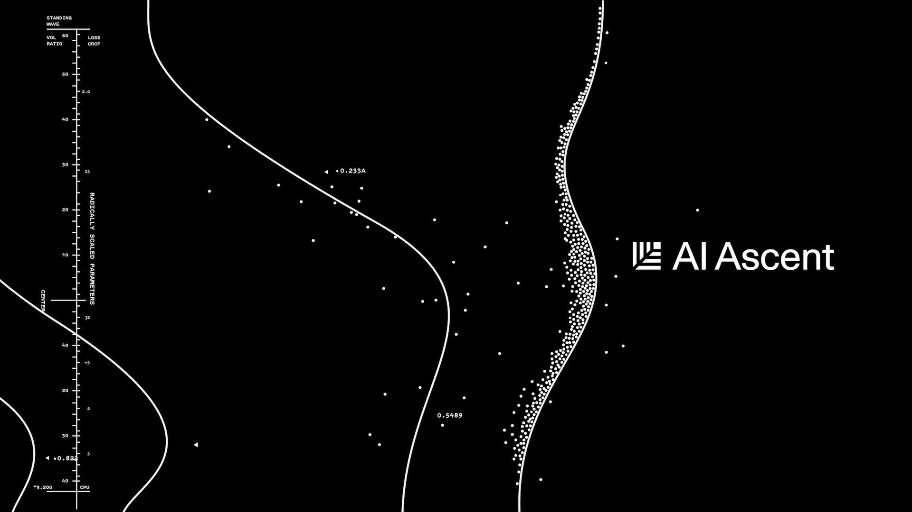

# (99+ 封私信 / 80 条消息) AI agent到底有多大创新？

昨晚睡前看了Andrej Karpathy在[AI Ascent](https://zhida.zhihu.com/search?content_id=780416507&content_type=Answer&match_order=1&q=AI+Ascent&zhida_source=entity)的talk视频，有点被shock到了，久久不能入睡（AI Ascent是红杉资本主办的AI创业和投资圈的“风向标级闭门峰会”）。正好我前阵子也有**[LLM](https://zhida.zhihu.com/search?content_id=780416507&content_type=Answer&match_order=1&q=LLM&zhida_source=entity)是一种new computer的感觉**，而AK说的更直接：这不仅是可以给已经能做的提效，而是**打开了新世界的大门**，能做以前根本想象不到的。

29:48

Andrej Karpathy-From Vibe Coding to Agentic Engine

当前的一个共识是：目前进入Agent产品阶段，召唤着这个时代的乔布斯。这是 iOS 的 App Store 前夜，是属于超级产品经理的黄金时代。

然而顺着**LLM Is the New Computer**逻辑的进一步技术思考是：类比上世纪40~90年代，computer蓬勃发展，关于[图灵机](https://zhida.zhihu.com/search?content_id=780416507&content_type=Answer&match_order=1&q=%E5%9B%BE%E7%81%B5%E6%9C%BA&zhida_source=entity)、计算机的架构（冯诺依曼）、指令集、编译器都在百花齐放、野蛮生长。这个new compute age，所有工程技术都需要重构或者说是全新创造。

所以不要苛责现在的LLM computer哪里不好用，抱怨agent偶尔有多蠢，**面对范式迁移，重要的是要躬身入局，对技术的能力边界和发展趋势有真实的体感，跟上技术的发展，不要被时代的洪流抛弃**。

> **以后能用就尽量多用当前的agent产品，不仅用还要多思考，多了解技术底层**。这个视频是Claude Code自动：从youtube拉视频+音频 + Whisper V3模型语音识别 + 制作中英字幕 + 压制视频。并且我也制作成了skill。

我把这场演讲中最击中我的5个核心洞察整理了出来，分享给同样在这个时代洪流中的你。

## **01 / 范式转移：[Software 3.0](https://zhida.zhihu.com/search?content_id=780416507&content_type=Answer&match_order=1&q=Software+3.0&zhida_source=entity) 与 “LLM作为新计算机”**

**从未感到如此落后。** 从去年 12 月起，随着模型能力的跃升，AI 生成的代码块几乎不再需要人类纠错。这种断崖式的体验让 AK 感到“作为程序员从未如此落后”，并促使他全面转向“Vibe Coding”。

**我们正在迈入 Software 3.0 时代。** Software 1.0 是编写明确的规则（写代码）；Software 2.0 是训练神经网络的权重；Software 3.0 则是 **Prompting**。在这个新纪元里，LLM 变成了新的“计算机（解释器）”，而上下文窗口（Context Window）就是你操控这台计算机的杠杆。

**这不仅是提效，而是创造全新可能。** Software 3.0 消灭了中间的应用程序层。例如他的 MenuGen（菜单翻译器）项目，在旧范式下需要写代码、做 OCR、部署服务器；但在新范式下，只需要把菜单照片扔给大模型，模型就能直接渲染出带图的新菜单。很多以前无法想象的“非结构化信息处理”现在成为了可能。

**未来的计算形态将发生反转。** 在 20 世纪 50 和 60 年代的计算早期，人们并不确定未来的计算机应该长得像“计算器”还是像“神经网络”。历史上我们选择了“计算器”（即经典计算）的道路，导致现在的神经网络是虚拟化运行在现有计算机之上的。但随着 LLM 成为新计算机，这种架构可能会完全反转——**神经网络将成为控制一切的“主进程（Host Process）”，而传统的 CPU 反而沦为处理历史遗留确定性任务的“协处理器（Co-processor）”。**

## **02 / 锯齿状智能（Jagged Intelligence）与可验证性（Verifiability）**

本质上，传统计算机擅长自动化你能“明确说明（Specify）”的东西，而 **LLM 擅长自动化你能“验证（Verify）”的东西**（比如代码运行是否报错、数学题对不对）。

预训练模型学习的是统计概率分布，而 **RL（强化学习）如同电路连接**，在上面建立快速连接。

如果你**工作在被大厂用海量数据和 RL 强化过的“电路”里（如写代码），你会感觉像光速一样快**。如果你**处于数据分布之外（缺乏 RL 强化），模型就会显得很蠢**。

**这里藏着给创业者的巨大红利：** 如果你所在的领域是“可验证”的，哪怕大厂还没盯上，你完全可以自己构建 RL 环境并按下“微调”按钮，从而获得一个极其强大的专属模型。

## **03 / Vibe Coding (下限) vs. Agentic Engineering (上限)**

现在的开发模式正在发生严重的两极分化。

一方面是 **“Vibe Coding”** 的兴起。只要有想法，用自然语言就能写代码，这极大地拉高了大众参与软件开发的下限。

但另一方面，为了在**不牺牲专业软件质量和安全性的前提下走得更快**，我们需要一门全新的学科——**智能体工程（Agentic Engineering）**。

未来的顶尖工程师，不再是能手写红黑树的人，而是能协调一群强大但偶尔犯错的 Agent 的指挥官。未来的大厂面试，可能不再是做算法题，而是让你搭一个 Agent 版的 Twitter，然后用 10 个高级 AI 去疯狂攻击它，看你的架构能不能扛得住。

## **04 / 人类的核心价值：品味、判断与理解**

在这个连代码都可以自动生成的时代，人类到底还有什么用？

AK 的答案很犀利：目前的 Agent 只是一个记忆力超群但缺乏常识的“实习生”。**人类必须负责顶层设计、审美（Aesthetics）、判断力（Judgment）和品味（Taste）**。

**忘掉那些繁琐的 API 吧。** 你不需要再死记硬背 Pandas 或 PyTorch 的参数细节，但你**必须懂底层的工程逻辑**（比如内存是如何分配的，张量视图是如何运作的），这样才能对“实习生”**提出正确的需求**。

随着智能变得越来越廉价，**你可以把“思考”的过程外包给 AI，但你永远无法外包“理解”**。人类，依然是决定“我们要建什么”以及“为什么有价值”的唯一瓶颈

## **05 / 幽灵与 Agent 原生世界**

最后，我们需要重新认识 AI 的本质。

它们是幽灵，不是动物。它们没有内在动机、好奇心或进化本能，它们只是被数据和奖励函数塑造的统计模拟电路。理解了这一点，我们就**不会对它们抱有拟人化的错误期待**。

目前的 API 和开发文档，依然是“写给人类看的”，充满了废话和引导。但**未来的世界，注定是Agent-Native的**。

基础设施将被拆分为适合 Agent 直接调用的“传感器”和“执行器”。你的 Agent 会直接与别人的 Agent 沟通并完成任务。

[发布于2026-05-07 00:15](https://www.zhihu.com/question/657739588/answer/2035512976262811660)・上海

​赞同 236​​9 条评论​446 ​12 

​分享

​收起​

[如何写代码？豆包一键实现，程序员必备！

编程大佬们都在用的豆包AI!爬虫、写代码、修复bug等查看详情编程大佬们都在用的豆包AI!爬虫、写代码、修复bug等 查看详情

豆包的广告](https://www.doubao.com/chat/?channel=dbweb_zhihu_xxl_pc_cpc_ty_aibc_bchx_516&source=dbweb_zhihu_xxl_pc_cpc_ty_aibc_bchx_516&keywordid=3734831&ad_platform_id=zhihu_feed_lead&ug_callback_url=https%3A%2F%2Fsugar.zhihu.com%2Fplutus_adreaper_callback%3Fsi%3Dee708ef9-6ec5-4e7b-9825-5c68854ab9ea%26os%3D3%26zid%3D1628%26zaid%3D3744384%26zcid%3D3734833%26cid%3D3734831%26event%3D__EVENTTYPE__%26value%3D__EVENTVALUE__%26ts%3D__TIMESTAMP__%26cts%3D__TS__%26mh%3D5315d2615d16100da955c1137d73c373%26adv%3D784531%26ocg%3D0%26cp%3D0%26ocs%3D0%26aic%3D0%26atp%3D0%26ct%3D0%26ed%3DGiBNJgVzfCMmUW9XFyEvRA8xBGxJICwkOhh0FlwxKw1Gdx87VSAsMi9Cb1cXISFcCiIEeh4yNyw9GGJBRCUlVFZ0DngJcmN3ehFkUwBkfwNZY1YkXSo-fX4DPhIMZHgDWXAOeQ7O3iQskuRW8Q%3D%3D&cb=https%3A%2F%2Fsugar.zhihu.com%2Fplutus_adreaper_callback%3Fsi%3Dee708ef9-6ec5-4e7b-9825-5c68854ab9ea%26os%3D3%26zid%3D1628%26zaid%3D3744384%26zcid%3D3734833%26cid%3D3734831%26event%3D__EVENTTYPE__%26value%3D__EVENTVALUE__%26ts%3D__TIMESTAMP__%26cts%3D__TS__%26mh%3D5315d2615d16100da955c1137d73c373%26adv%3D784531%26ocg%3D0%26cp%3D0%26ocs%3D0%26aic%3D0%26atp%3D0%26ct%3D0%26ed%3DGiBNJgVzfCMmUW9XFyEvRA8xBGxJICwkOhh0FlwxKw1Gdx87VSAsMi9Cb1cXISFcCiIEeh4yNyw9GGJBRCUlVFZ0DngJcmN3ehFkUwBkfwNZY1YkXSo-fX4DPhIMZHgDWXAOeQ7O3iQskuRW8Q%3D%3D&ug_semver=v1.0.0&spu=biz%3D0%26ci%3D3734833%26si%3D1633dc61-4a59-43f2-aacc-2ab269957e35%26ts%3D1780792434%26zid%3D1628)

#### 更多回答

[sunnyzhao](https://www.zhihu.com/people/sunnyzhao-83)

做梦当大侠

​ 关注

[谢邀 @托狸](https://www.zhihu.com/people/f45702fcf8b7d19ce0bf2be2a8f4ac94)
