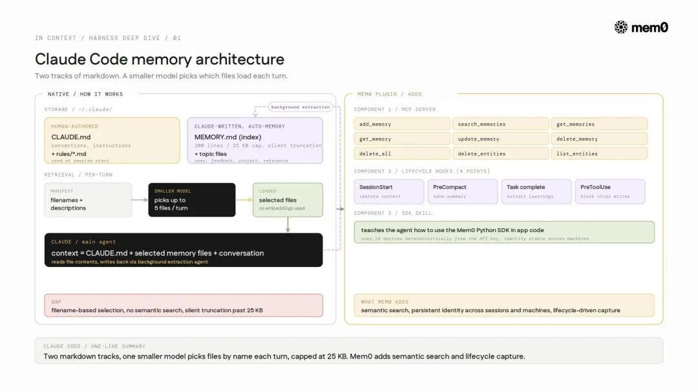
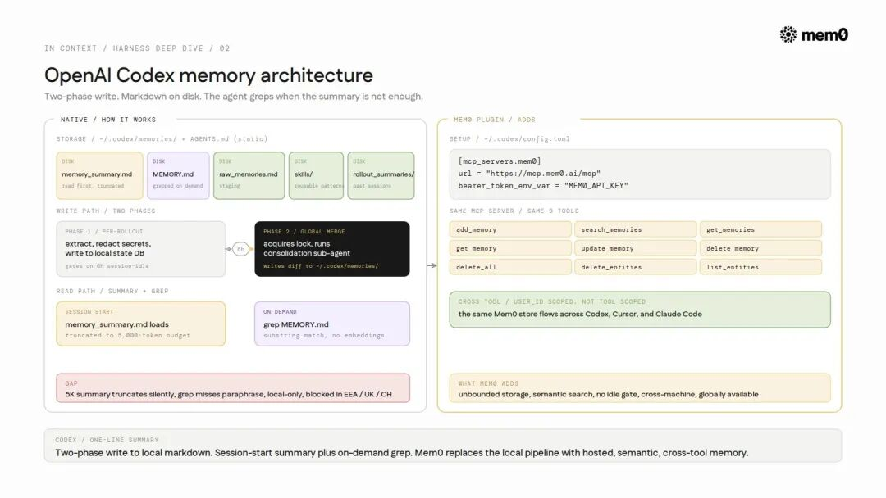
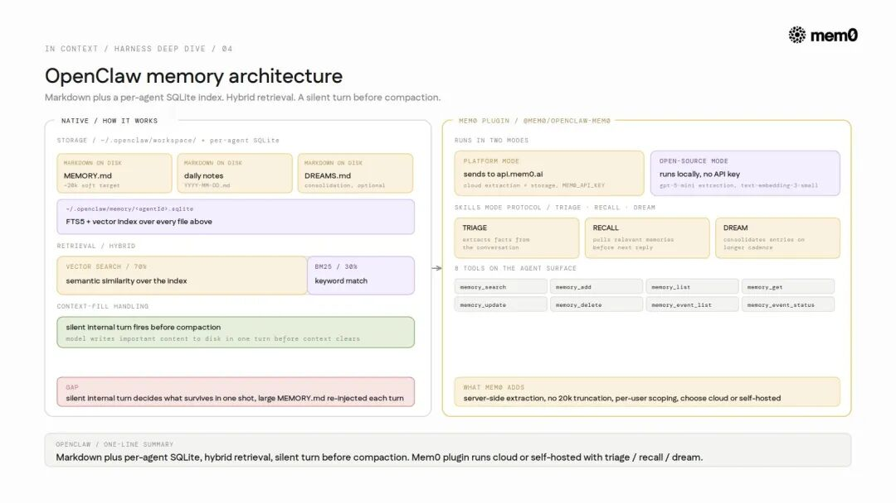
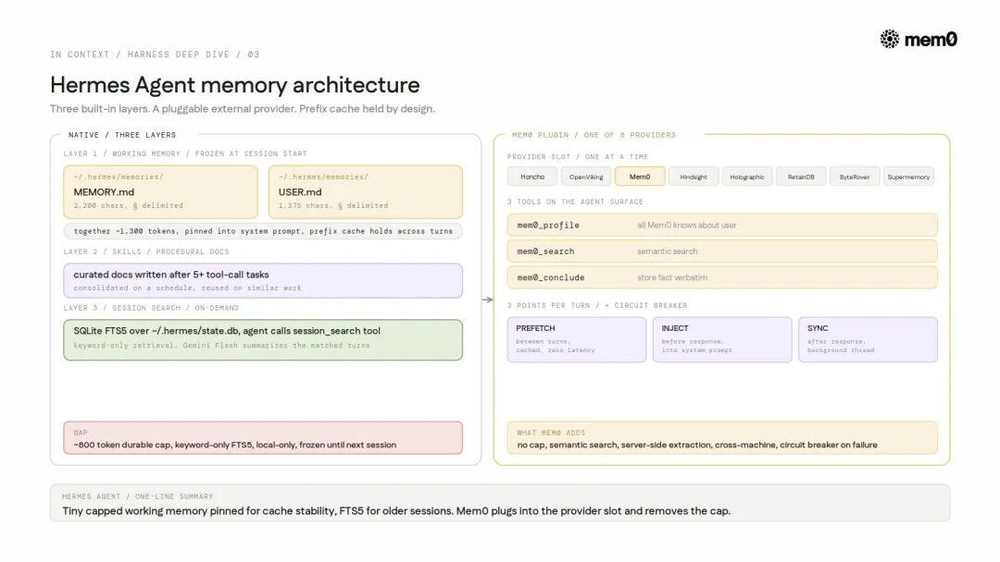
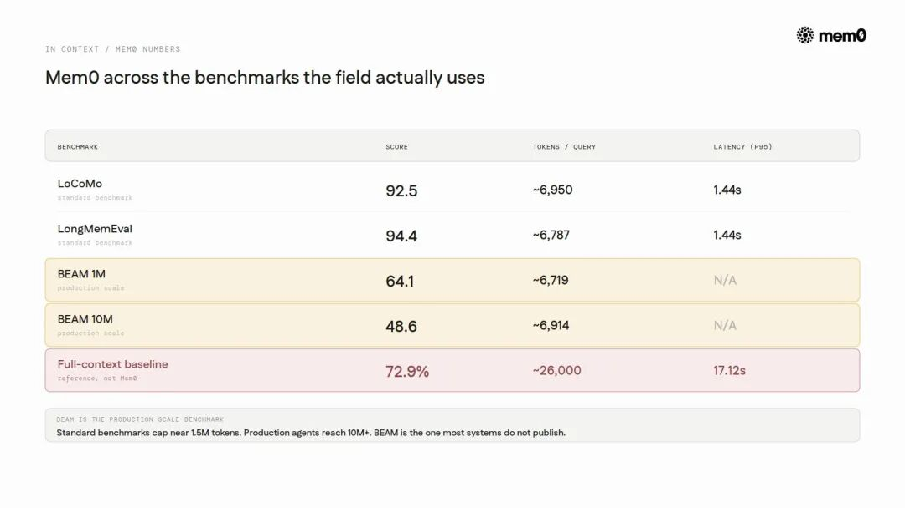

# 9大Harness的记忆能力对比

导读

这篇文章有意思的地方，不在于又讲了一遍“AI Agent 需要记忆”。这事大家都知道。真正麻烦的是，当 Agent 开始真的写代码、调工具、跨会话工作以后，记忆到底放在哪、谁来检索、什么时候过期、怎么防止串用户。

Mem0 这篇 X Article 把 Claude Code、Codex、OpenClaw、Hermes、Copilot、Devin、Windsurf、AWS AgentCore 等几个常见 Agent Harness 拉到一张桌上对比。它当然带有 Mem0 自己的产品视角，但里面对“记忆为什么正在从功能变成基础设施”的判断，值得开发者认真看一眼。

Agent Harness，可以理解为 AI 软件真正跑起来的“运行壳”。Claude Code、Codex、Cursor 这类环境，不只是把模型接进来聊天，它们还负责上下文管理、工具编排、多 Agent 协作，以及越来越关键的记忆管理。

问题就在这，真正交付软件的东西，越来越不只是模型，而是这个 Harness。

记忆正是 Harness 设计里最难的地方。它应该放在哪里？一次会话结束后，什么东西应该留下？窗口被塞满以后，哪些信息应该被压缩、保留或丢掉？这些问题还没有统一答案，所以每个主流 Harness 都在用自己的方式试。

## Agent 记忆到底是什么

很多系统都说自己有 memory，但这里至少有三类完全不同的东西。混在一起讲，很容易把问题讲糊。

- **工作记忆（Working memory）**：会话期间留在上下文窗口里的内容。会话结束通常就没了。上下文压缩，也就是窗口满了以后什么能活下来，属于这一层的问题。
- **外部记忆（External memory）**：存在模型权重之外的内容，比如向量数据库、知识图谱、文件。它能跨会话保留，但模型权重本身不变。到 2026 年，生产环境里的记忆基本都在这一层。
- **参数记忆（Parametric memory）**：通过梯度下降写进模型权重里的知识。它不是检索例子，而是把规则泛化出来。但原文判断，2026 年还没有真正的生产部署。

认知科学里常说的语义记忆、情景记忆、程序性记忆，描述的是“存什么”。上面这三层讲的是“存在哪里”。这两个维度别混。

文章引用了论文《Contextual Agentic Memory is a Memo, Not True Memory》里面有一个很锋利的结论：如果想让检索式记忆达到参数记忆的效果，可能需要 Ω(k²) 规模的存储样本，而参数记忆只需要 O(d) 的权重更新。下面这些系统，基本都还活在这个天花板下面。

## 主流 Harness 都交付了什么

九个 Harness 的记忆能力对比

### 1. Claude Code

Claude Code 走了两条线。

`CLAUDE.md` 是人写的配置，通常放项目约定、指令和开发偏好，会在会话开始时读取。`Auto-memory` 则是 Claude 通过后台提取 Agent 写出来的笔记，存放在 `~/.claude/projects/<repo>/memory/` 下，围绕一个 `MEMORY.md` 索引组织。这个索引有上限，200 行或 25KB，内容分成 user、feedback、project、reference 四类。

限制主要来自检索方式。每一轮里，Claude Code 会把文件名和描述交给一个更小的模型，由它决定加载哪些文件。没有 embedding，最多加载 5 个文件，超过上限还可能静默截断。也就是说，一个名字看起来相关的文件，可能打败真正相关的文件。

Claude Code 记忆架构

**短板**：它按文件名选择，不是语义搜索。团队共享能力藏在 `TEAMMEM` 标志后面，但底层仍然是本地、仓库级 Markdown，没有语义索引。

### 2. Anthropic Managed Agents

Managed Agents 是 Anthropic 的托管 Agent 运行时，不是 Claude Code 那种本地产品。它的会话是一个只追加不修改的事件日志，所以回滚和审计是架构内生的，不是后面补的。

记忆存储以文件系统形式挂载到 `/mnt/memory/`，每个 workspace 最多 8 个 store，每个大约 100KB。每次写入都是不可变版本，多个 Agent 可以共享同一个 store，并留下可审计历史。

**短板**：它更适合 workspace 级别的多 Agent 协调，而不是长期个人记忆。100KB 上限和 workspace 作用域意味着，跨会话个人上下文还得在上层再搭一套模式。

### 3. OpenAI Codex

Codex 的记忆是一组 Markdown 目录，位置在 `~/.codex/memories/`，没有 SQLite，也没有 embeddings。`memory_summary.md` 会先读，`MEMORY.md` 按需用 `grep` 查，旁边还有 `raw_memories.md`、`skills/`、`rollout_summaries/`。功能默认关闭，需要 `features.memories` 开关。

它的写入路径分两段。

第一段是每个 rollout 自己做。会话空闲 6 小时后，Codex 按严格 schema 抽取记忆、脱敏密钥，然后写到本地状态数据库，还不是写进记忆目录。

第二段是全局合并。系统拿锁后启动一个 consolidation 子 Agent，决定合并、打补丁或丢弃，再把 diff 写进去。这个流程有边界，最多 256 个 rollouts，会按 30 天剪枝，也会考虑限流。

读取路径则不是语义检索。summary 会被截到固定 5,000 token 预算，其他内容靠 `grep` 从 `MEMORY.md` 里找。

Codex 记忆架构

**短板**：5,000 token summary 会静默截断；`grep` 只能匹配子串，改写过的事实可能完全找不到；6 小时空闲门槛让连续会话很难及时合并；状态是本地的；发布初期 EEA、英国和瑞士不可用。

### 4. GitHub Copilot

Copilot 最有辨识度的动作，是 **即时引用校验（just-in-time citation verification）**。

它的记忆项不是一段泛泛文本，而是结构化对象：subject、事实内容、文件与行号引用、reasoning。使用之前，Agent 会拿当前分支校验引用。如果代码已经和记忆冲突，它会重写这条记忆。记忆还会在 28 天后自动过期。

这也是少数公开了真实生产效果的数据：A/B 测试里，开启记忆后 PR 合并率从 83% 提升到 90%，代码审查 precision 提升 3%，recall 提升 4%。在编码 Agent 记忆这块，这个 7 个百分点的提升是少见的真实世界指标，其他系统更多还停在 benchmark。

**短板**：这种引用 schema 很难容纳没有明确代码锚点的偏好事实，比如“偏好少抽象”。另外，它严格限定在 repo 作用域里。

### 5. OpenClaw

OpenClaw 的原生记忆比看起来更强。它在 `~/.openclaw/workspace` 里存 Markdown，包括维护过的 `MEMORY.md` 和按日期记录的 daily logs。底层还有每个 Agent 独立的 SQLite 索引，带 embeddings 和混合检索，70% 向量、30% BM25。所以它原生就有语义搜索。

OpenClaw 记忆架构

麻烦在于什么东西能留下。当窗口满了，OpenClaw 会触发一次“静默内部回合”，让模型在清空前把重要内容写到磁盘。写进去什么，取决于模型那一轮的判断。长期记忆因此会选择性强、稳定性不一致。

Mem0 插件 `@mem0/openclaw-mem0` 想解决的就是这个依赖。`Auto-Recall` 在每轮前注入相关记忆，`Auto-Capture` 在每轮后持久化交流内容，新事实会存起来，旧事实会更新，重复内容会合并，并通过 session `run_id` 和长期 `userId` 管作用域。

文章认为，OpenClaw 24.7 万 star 的采用，很大一部分就是被这个缺口推动的。

### 6. Hermes Agent

Hermes 有 13.5 万 star、200 多个模型，内置三层记忆，又支持 8 个可插拔 provider。

第一层是工作记忆：`MEMORY.md` 约 2,200 字符，`USER.md` 约 1,375 字符，加起来约 1,300 token。内容用 `§` 分隔，有利用率指示，并在容量到 80% 时做 consolidation。写入会落盘，但系统 prompt 会拿到一个冻结快照直到下一次会话，以保住 prefix cache。

第二层是 skills：5 次以上工具调用任务后写成程序性文档，并按计划维护。

第三层是 session search：用 SQLite FTS5 对所有会话做全文检索，并按需总结。

Hermes Agent 记忆架构

**短板**：持久记忆上限很小，约 800 token。FTS5 是关键词检索，“429 errors” 不会匹配 “rate limiting”。状态也是本地的。正因为如此，Hermes 留了 provider 插槽。接 Mem0 后，上限、语义检索、服务端抽取和 `MEM0_USER_ID` 作用域都可以由外部系统接管；即使服务挂了，还有 circuit breaker 让内置层继续工作。

### 7. AWS Bedrock AgentCore

AgentCore 是 AWS 的托管 Agent 平台。它的 `Runtime` 是 Harness 层，可以类比 Anthropic Managed Agents；`Memory` 是托管记忆服务。

Memory 有三种异步抽取策略：语义事实、偏好、叙事总结。抽取大约 20 到 40 秒，检索约 200ms。发生变化的事实不会直接删除，而是标记为 `INVALID`，这样可以保留 lineage。

公开指标包括 LoCoMo 70.58、PrefEval 79、PolyBench-QA 83.02。

**短板**：它是 AWS 特定生态，有锁定问题；公开的 LoCoMo 分数也低于领先的记忆系统。

### 8. Windsurf

Windsurf 的记忆由 Cascade 引擎自动生成和管理，开发者没有太多工作流可控。记忆以本地、workspace 级文件形式存放在 `~/.codeium/windsurf/memories/`，主要捕捉代码库模式和约定。

**短板**：捕捉什么由 Cascade 决定，不是开发者决定。记忆限定在 workspace 里，跨项目不可见，也没有跨设备或团队共享。

### 9. Cognition Devin

Devin 把记忆分成两块。

`Knowledge` 是人工维护的 trigger-content 事实，不自动捕获。`DeepWiki` 是参考文档，上限是 30 页、100 条 notes，每条 10,000 字符。Devin 会在会话后建议新增 Knowledge，但必须人类批准后才会存进去。

**短板**：人工审批能保证质量，但也带来摩擦。团队如果不审核，就什么都沉淀不下来。限制也不算高，而且 Knowledge 是给 Devin 用的，不会迁移到其他工具。

## 记忆 Benchmark 本身也很薄

文章对现有 benchmark 的批评很直接：多数测试还停留在“能不能从过去对话里回忆事实”。它们接近饱和，而且高分不一定代表 Agent 会做出更好决策。

LoCoMo 被点名批评得最重。它只有 10 段对话，比较不稳定；不少问题不需要真正记忆，一个简单 `grep` baseline 也能到约 74%；对抗问题还常常和目标有表面相似性，模型可能靠 pattern matching 过关。

LongMemEval 相对还算能用。它有 500 个 curated questions，覆盖信息抽取、多会话推理、时间推理、知识更新和拒答，规模扩到约 150 万 token。但它仍然偏 recall。

更深的问题是，很多 benchmark 根本不测“记忆是否能指导行动”。MemoryArena（arXiv:2602.16313）就显示，一些在 LoCoMo 和 LongMemEval 接近饱和的系统，到了行动场景会失败。Anatomy of Agentic Memory（arXiv:2602.19320）也把这个批评形式化了：这些榜单测的是相似度，不是任务效用。

还有生产规模。标准 benchmark 多数卡在 150 万 token 左右，但生产 Agent 很快会累积到 1,000 万 token 以上。BEAM（ICLR 2026）是少数为这个范围设计的 benchmark。比较诚实的结论是，记忆领域还需要新的 benchmark，现有 leaderboard 要谨慎看，下面这些分数也一样。

## 研究显示还有哪些没解决

**稳定性与可塑性困境只是换了地方。** 把记忆挪到外部，并没有结束灾难性遗忘。《When Continual Learning Moves to Memory》显示，新旧记忆会争夺检索槽位，就像以前争夺权重一样。来自简单任务的原始轨迹，甚至会伤害更难任务，forward transfer 为 -9.5%。

**选择性遗忘还没解决。** MemoryAgentBench（arXiv:2507.05257）定义了四种能力。系统能处理检索，但还很难做到选择性遗忘，也就是忘掉一个过期事实，同时保留围绕它的结构。

**记忆也是攻击面。** 《No Attacker Needed》（arXiv:2604.01350）测到正常使用下 57% 到 71% 的跨用户污染。记忆投毒攻击成功率则在 6% 到 38% 之间（arXiv:2601.05504）。

## 短板里反复出现的模式

这些系统的短板其实很像。

存储常常是**有上限且本地化**的，比如 Claude Code 25KB、Hermes 2,200 字符、Codex 5,000 token 加载预算。

检索大多还是**关键词式**的，比如 Claude Code 按文件名，Codex 用 `grep`，Hermes 用 FTS5。少数有语义搜索的系统，要么仍受本地和压缩限制，比如 OpenClaw；要么锁在云服务生态里，比如 AgentCore。

记忆还普遍是 **Harness 作用域**。Claude Code 的记忆，对 Codex 来说没有意义。**过期处理**很弱，除了 Copilot 之外很少有系统认真处理 stale memory。**隔离**也经常是事后才想起来，所以才会出现前面提到的污染数字。

这就是 Harness 边界的限制。

## Mem0 的位置

Mem0 针对的就是这个边界之外的问题。它的架构是混合式的：向量存储负责语义检索，知识图谱负责关系推理，key-value 负责快速元数据。

v3 算法在 2026 年 4 月改成了单次 ADD-only 抽取、多信号检索，也就是语义、BM25、实体链接一轮完成，并把实体链接放进向量存储里，移除了 v2 的外部图数据库。

Mem0 记忆算法

文章给出的数据是，Mem0 每次查询约 6,900 token、1.44 秒；full-context retrieval 则约 26,000 token、17.12 秒。

对应前面那些短板，Mem0 的卖点是：没有固定上限的外部 store；多信号检索，能找回上个月关于 auth endpoint 的讨论，即使说法已经变了；按身份隔离的 memory namespace，避免一个用户的记忆泄漏到另一个用户那里。

它也不只是理论。文章提到 Mem0 已经覆盖上面这些 Harness，包括 Claude Code 插件、Codex MCP server、Hermes 和 OpenClaw provider、AWS Strands 原生集成，以及 21 个 framework 和 20 个 vector store。

换句话说，记忆正在从每个 Harness 里的小功能，变成一层基础设施。

## 现在走到哪了

记忆已经变成基础设施。主流 Harness 都开始交付它，因为一个 Agent 如果只在单次会话里聪明，跨会话就失忆，那它的能力边界会非常明显。

这些 Harness 原生实现已经有进步，但它们常常在同一条边界上断掉：本地且有上限的存储、关键词检索、Harness 作用域、薄弱的 stale memory 处理，以及隔离缺口。

用来衡量它们的 benchmark 本身也不够强。真正接近生产规模的 BEAM，恰恰是很多系统还没报告的。

整体看，Mem0 想补的是一层可移植、语义可检索、跨 Agent、能扛住生产 token 规模的记忆基础设施。

Mem0 是一个面向 LLM 和 AI Agent 的开源智能记忆层，目标是提供长期、个性化、具备上下文感知的跨会话交互。

- 开源仓库：github.com/mem0ai/mem0

原文：https://x.com/mem0ai/status/2061822612398014782?s=20
