# Agent Harness Engineering全景综述，决定Agent系统的上限

## 一、背景

**Agent Harness Engineering**：大模型LLM的**全栈基础设施层**，**包含执行环境、工具协议、上下文管理、编排调度、可观测性、验证评估、安全治理七大模块**。

简单公式：**Agent= LLM + Harness Engineering**

> 核心结论：**生产环境中智能体可靠性，由Harness框架决定，而非大模型本身**。仅优化Harness、不改动模型权重，就能让基准任务提升**10倍编码成绩、13.7%终端基准得分**，远超模型迭代2%-4%的常规增益。

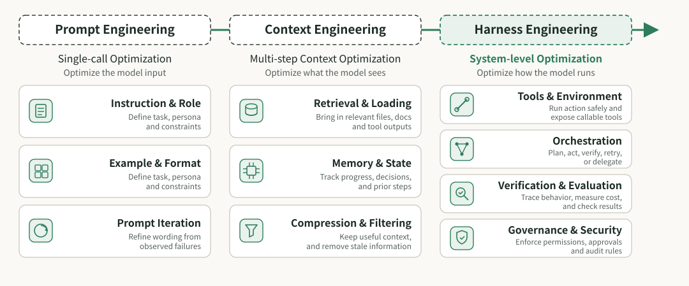

提示工程、上下文工程和Harness工程的简要对比

### 三大核心贡献

1. **约束条件，模型上的 Harness**：长周期智能体任务中，基准性能差异**源于Harness而非模型**，**Harness是独立且决定上限的系统层**。
2. **ETCLOVG七层分类法**：首创七层架构，将**可观测性、治理**升级为独立一级层级（突破传统六层框架局限）。
3. **生态实证**：映射**170+开源Agent项目**，绘制行业生态图谱，明确技术空白与主流设计原则。

## 二、智能体系统的三个阶段

### 预备知识

- 智能体定义公式：$Agent = LLM + Harness$

> 大模型仅负责推理，Harness承载**状态记忆、工具执行、终止条件、故障恢复**所有工程能力。

- 性能增益公式：$\Delta Performance_{Harness} \gg \Delta Performance_{Model}$

> Harness优化带来5%-100%提升，模型迭代仅2%-4%

### 1. 三阶段迭代模型（2022-2026）

2022 年至 2026 年代表性 agent-harness 系统时间线。该时间线展示了从早期单循环 agent 到更丰富的 harness 基础设施 的演进，涵盖执行环境、工具接口、上下文与内存管理、生命周期编排、可观测性、验证和治理。

- 时间维度：**2022（ReAct）→2023（多智能体）→2025（Harness转向）；**
- 演进特征：**从简陋While循环 → 多智能体协调 → 框架决定性能**；
- 里程碑：2026年OpenAI/Meta/LangChain验证Harness核心价值。

| 阶段 | 时间 | 核心命题 | 优化范围 | 工程层级 |
| --- | --- | --- | --- | --- |
| 提示工程 Prompt Engineering | 2022-2024 | 模型单次输入是什么 | 仅优化单轮Prompt文本 | 单点输入优化 |
| 上下文工程 Context Engineering | 2025 | 模型每一步该看什么 | 多轮信息流动态管理 | 多步状态优化 |
| 线束工程 Harness Engineering | 2026 | 模型如何稳定可靠运行 | 七层全栈跨层整合 | 系统级工程优化 |

基于 LLM 的智能体系统之 Harness 工程分类示意图。E、T、C、L 四层构成系统的结构支柱；O 层提供系统级监控；V 层 对各组件进行评估与反馈；G 层在整个系统上实施治理与安全约束。配色对应 ETCLOVG 七层

### 2.ETCLOVG七层架构

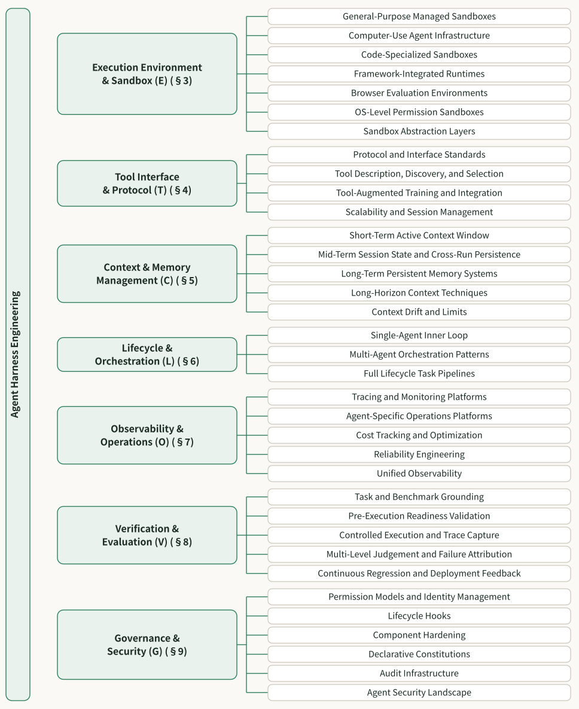

智能体Harness工程分类法的细节。每个分支对应一个 ETCLOVG 层及其主要子类别

每层拆解子类别，覆盖170+开源项目映射，清晰看出：

- 密集区：执行/工具/编排/验证；
- 薄弱区：可观测性、治理（开源少、商业闭源为主）；
- 空白区：任务运行器、多智能体编排、规范驱动工具。

**ETCLOVG** 七层拆分，分为**核心四层（运行底座）+ 控制三层（管控平面）**

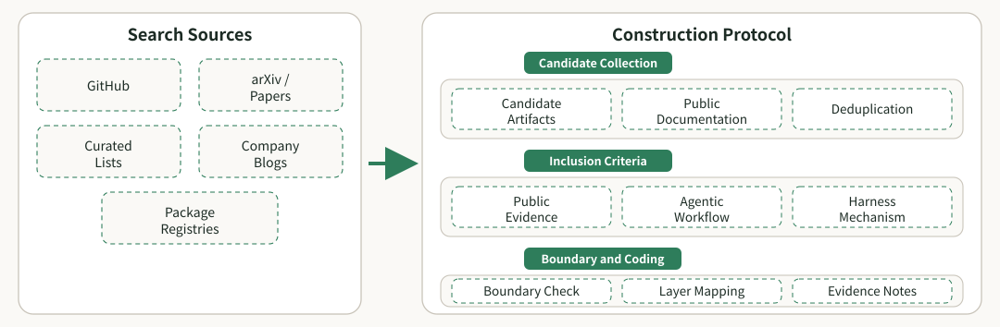

：语料库构建流程。候选工作从 GitHub、论文、精选列表、包注册表以及公司工程资源中收集，随后进行去重、依据纳入标准检查，并利用公开文档映射到 ETCLOVG 层。

- 职责：Agent运行载体、隔离防护、环境重置；细分7大类沙箱（通用托管/代码专用/浏览器环境等）。

1. **E-Execution 执行环境与沙箱**

> 核心价值：解决安全逃逸、可复现性、长任务自主权限问题。

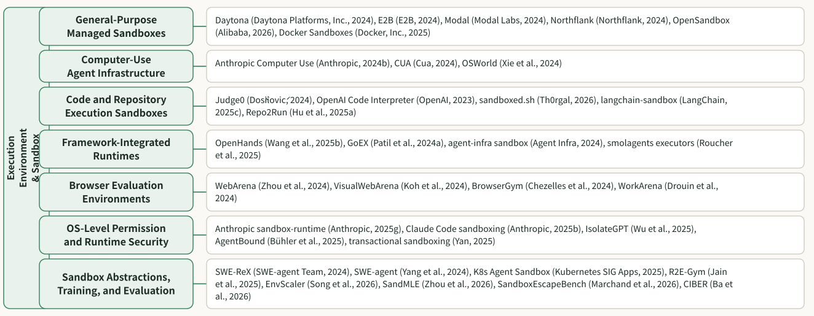

关于 LLM 智能体执行环境与sandbox的代表性工作

- 职责：工具描述、发现、调用、跨Agent通信；核心协议MCP/A2A/OpenAPI。

2. **T-Tool 工具接口与协议**

> 关键原则：少而精的工具集优于冗余堆砌，减少规划误差与Token消耗。

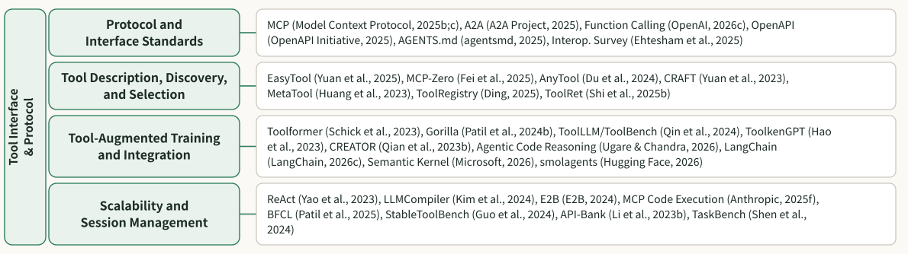

关于 LLM 智能体工具接口与协议的代表性工作

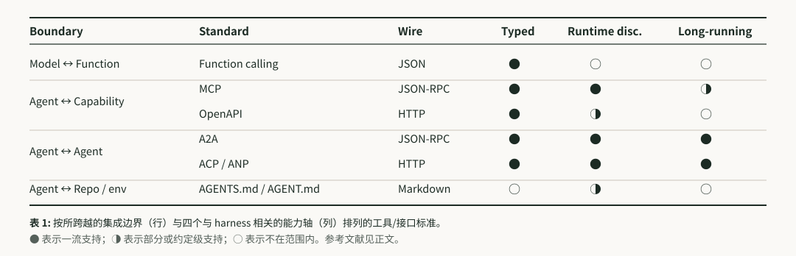

- 职责：管控模型每一步可见信息，分**短期窗口/会话中期/长期记忆**三级架构；

3. **C-Context 上下文与内存管理**

> 核心痛点：解决**上下文膨胀、信息U型衰减、上下文漂移**三大行业难题。

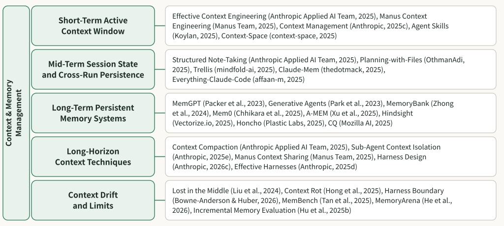

关于 LLM 智能体上下文与记忆管理的代表性工作

- 职责：单智能体循环、多智能体协作、全任务流水线； 主流模式：层级编排/团队协作/图组合/扇出并行。

4. **L-Lifecycle 生命周期与编排**

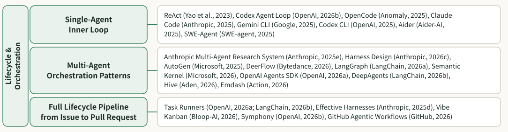

按本章编排类别整理的关于 LLM 智能体生命周期与编排的代表性工作

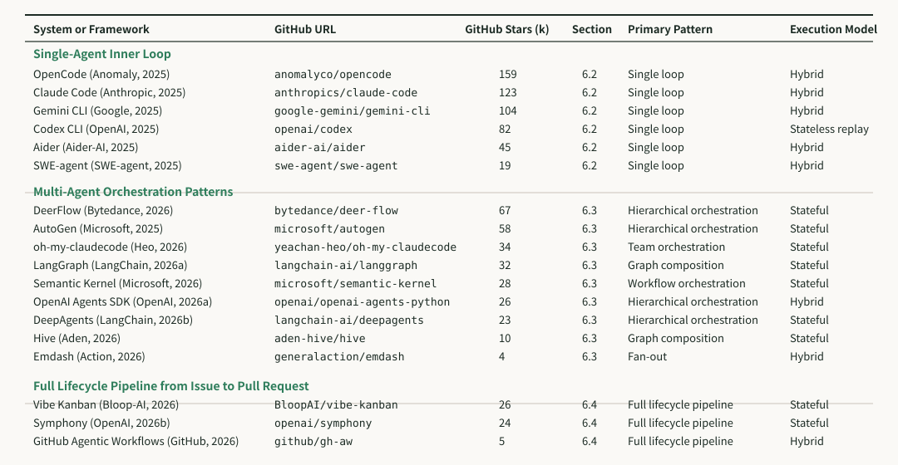

：代表性编排系统，按编排层级（单智能体：多智能体：全生命周期流水线：主要编排模式和执行模型分类。GitHub 星数四舍五入到千位，截至 2026 年 5 月 12 日记录

- 职责：链路追踪、成本监控、故障归因、可靠性工程； 生态：基于OpenTelemetry标准，代表工具Langfuse/Arize。

5. **O-Observability 可观测性与运维**

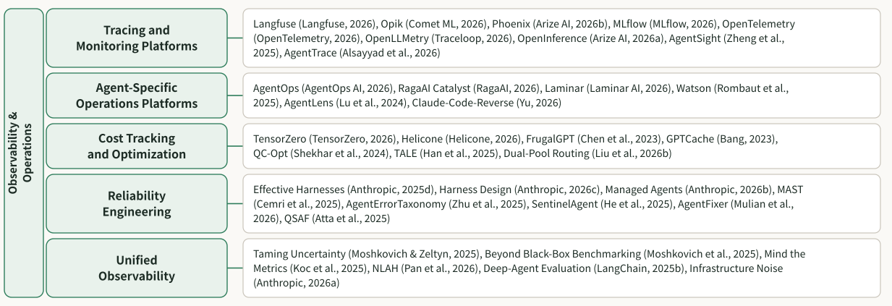

按本章操作类别整理的关于 LLM 智能体可观测性与运维的代表性工作

- 独创**五阶段任务反馈生命周期**：基准确立→执行就绪→轨迹捕获→多级评判→回归优化； 突破：不只看最终得分，更看执行路径、故障溯源。

6. **V-Verification 验证与评估**

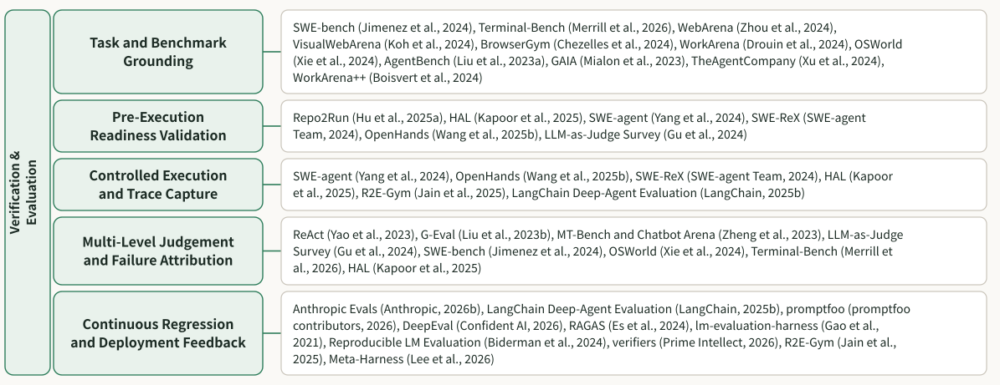

按本章“任务-反馈”生命周期组织的、面向 LLM 智能体验证与评估的代表性工作

：用于工具评估的任务-反馈生命周期。第 V 节将验证与评估组织为一个五阶段的质量控制循环：任务与基准的根基确立、 执行前的就绪验证、受控执行与追踪捕获、多层次判断与失败归因，以及持续回归与部署反馈。该图强调，工具评估不仅应报告最 终成功率，还应诊断失败根源，并将所得证据反馈到系统性的工具改进中

- 职责：权限管控、生命周期钩子、组件加固、审计合规、声明式宪章； 三层防护：模型级/系统级/组织级安全约束。

7. **G-Governance 治理与安全**

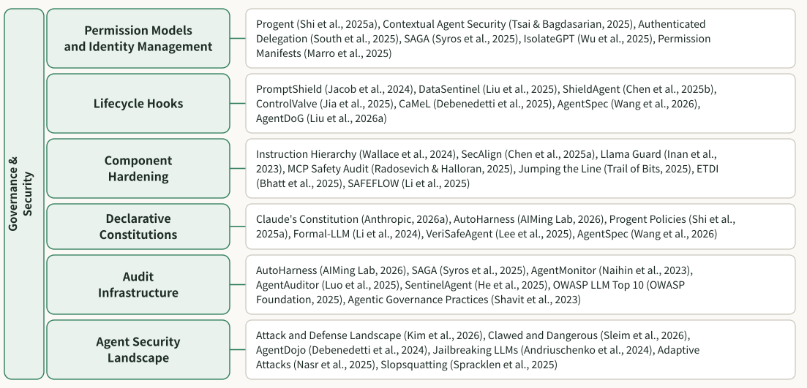

：按本章安全类别整理的关于 LLM 智能体治理与安全的代表性工作

LLM输入前、工具调用前、执行后、人工介入四拦截点，构成**事前-事中-事后**全治理闭环，是安全护栏核心设计范式。

生命周期钩子,一个工具使用周期中的四个钩子点。实线框表示代理组件；虚线框表示治理钩子。H1 在输入到达 LLM 之前进行验证，H2 在工具执行前验证拟议操作，H3 调解工具输出回流到上下文的信息流，H4 在用户批准前拦截具有重大影响的行动

### 2. 架构逻辑

- E/T/C/L：**系统结构支柱**，保障Agent能跑起来；
- O/V/G：**独立控制平面**，保障Agent跑得稳、可管控、可审计；
- 设计创新：首次把**可观测性、治理**从附属钩子升级为独立层级，匹配企业真实组织分工。

### 3. 关键逻辑

- 三层**包含关系**：Harness包含上下文工程，上下文工程包含提示工程，并非替代关系；
- 演进本质：从**单次文本优化** → **多轮信息管控** → **全生命周期系统治理**；
- 行业拐点：2026年OpenAI正式定义Harness为独立学科，标志行业从「调Prompt」进入「搭Harness」时代。

### 4. 论文关键观点

1. **成本-质量-速度三元悖论**更强安全/更全观测/更深入评估 → 成本升高、速度下降；生产级需做分层取舍，非全量拉满。
2. **能力-控制权衡**工具越多、能力越强 → 攻击面越大、失控风险越高；需通过权限沙箱、动态约束平衡。
3. **框架耦合问题**Harness七层相互关联，单层优化会连锁影响全局，**局部改动需全链路回归测试**。

## 未来方向

1. 执行环境加固：沙箱逃逸防御、跨平台可移植性；
2. 长任务状态维护：解决上下文漂移、记忆失真；
3. 轨迹故障诊断：从打分到根因自动定位；
4. 跨角色标准交接：Agent/工具/人类任务流转协议；
5. 模型与框架自适应简化：模型升级后自动裁剪冗余Harness约束。

## 参考

> Agent Harness Engineering: A Survey
