# 分享一些 AI 面试经验：简历与能力框架

导读：今天是求职面试相关课题，小钗在这里经验极其丰富：[连续 AI 创业失败，我所有的经验都在这了...](https://mp.weixin.qq.com/s?__biz=Mzg2MzcyODQ5MQ==&mid=2247499802&idx=1&sn=5cc7e43b9aff832bb88dbc31888d9049&scene=21#wechat_redirect)一定能给建议啦，然后本文阅读约 10 分钟，简单轻松！

最近做了一场 AI 分享会，下来吃饭的时候发现学员里面有 1/5 左右的同学是有找 AI 工作诉求的，然后很多典型故事就产生了：

1. **裸辞后**，对未来不管不顾，累了先玩半年再说，结果回来后发现工作貌似不好找；
2. **大幅降薪**，原来 40 左右的待遇，因为想要“轻松点”，接受了一份 10 的工作，但一线也很累啊；
3. **乱写简历**，也不管 HR 受不受得了，一份简历写了 10 页；
4. **“实事求是”**，更夸张的时候，只待几个月的经历也在上面，就显得这个人总是在跳槽；
5. ...

当然，这里并不是在说他们**技术/业务能力**不行，而是他们对**自身职业生涯的规划**、乃至对写简历、如做面试这种**偏门面**的事情做得很糙。

于是乎我今天又不得不捡起**管理课题老本行**，来聊聊：**如何准备面试**：

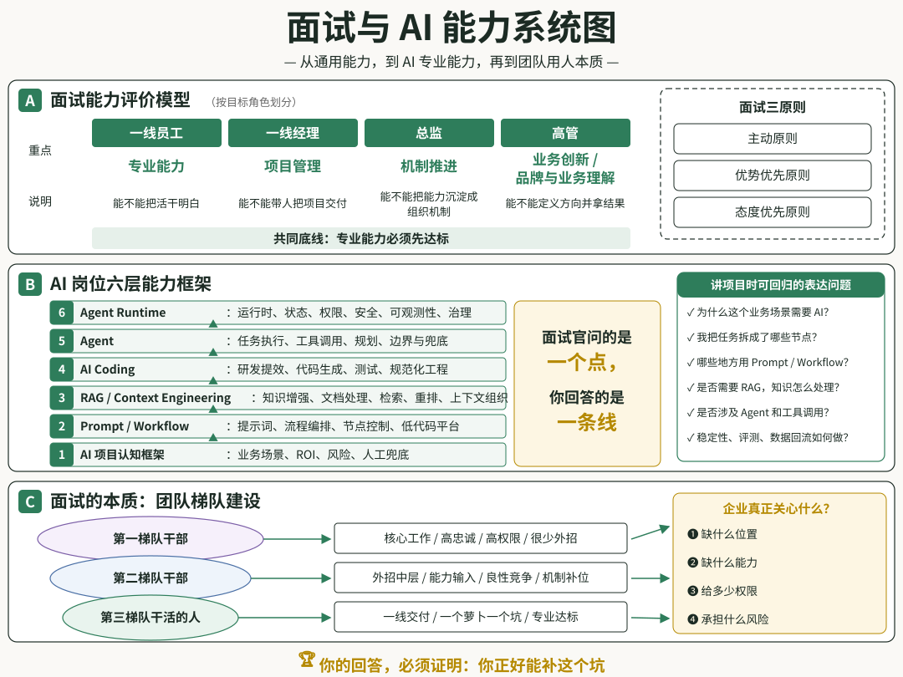

先从简历开始：

## 简历问题

俗话说：**简历写得好，工作随便找**，那我只能说你真的是**想多了**：

> 简历这个事情没大家想象那么重要...

一个人工龄到一定阶段后，简历重要就不太成立了，甚至**简历意义开始下降**，为什么这么说？

因为每个人都有包装的能力，简历所带来的信息会变得**失真严重**，所以我们只会相信其中客观的信息，什么是客观信息，也要分级：

1. 第一层级，造假成本极高。

- 学历信息；
- 公司信息；
- 薪酬信息；
- 专业技能类证书；

2. 第二层级，能很快辨明。

- 职位信息；

3. 第三层级，辨明成本高。

- 项目信息；
- 项目所处角色；

4. 第四层级，辨明成本极高（几无价值）。

- 自我评价；

作为企业用人单位，最为看重的**项目信息以及技能信息**，他们会是面试的重点，所以只要能说清楚就行。

从这个角度，我们来看什么是好的简历。

#### 好的简历

一份完整的简历，由 5 大块构成：**基本信息、教育经历、工作经历、项目经历、自我评价。**

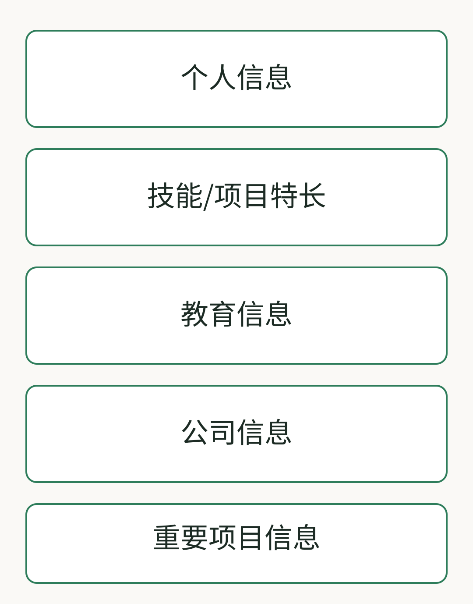

**在包含完整信息的情况下，信息越少越好**，这里有 2 份脱敏简历对比，大家可以感受下：

**第一份简历**

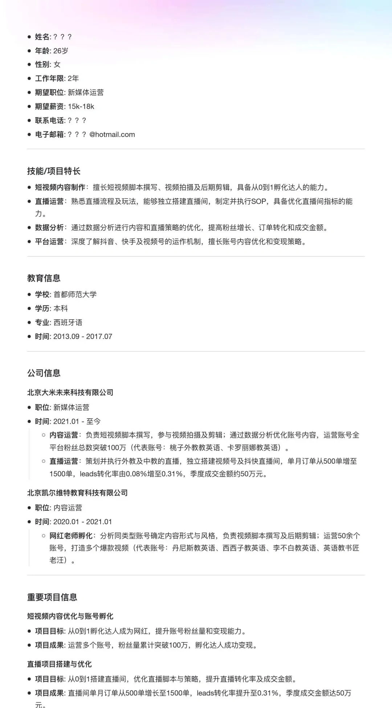

原件

**精炼后的简历**

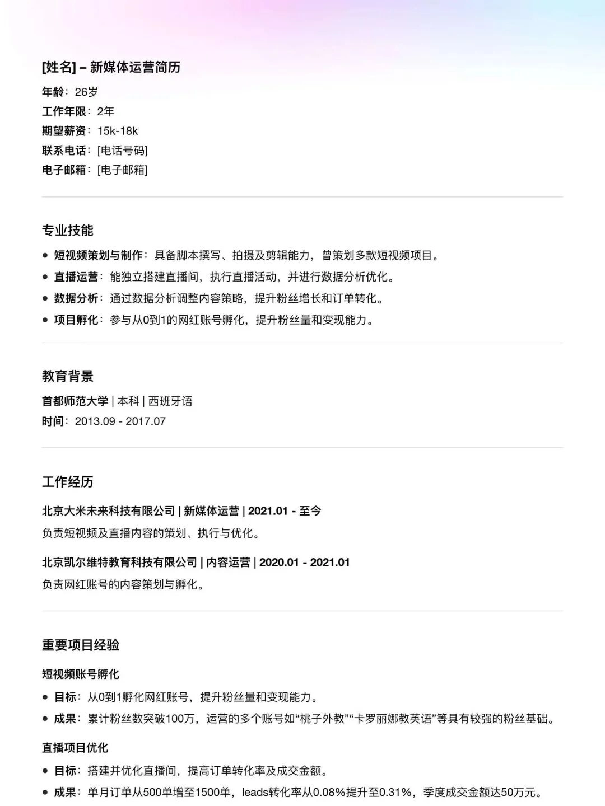

精炼

下图是他们的优化逻辑，大家可以对比下：

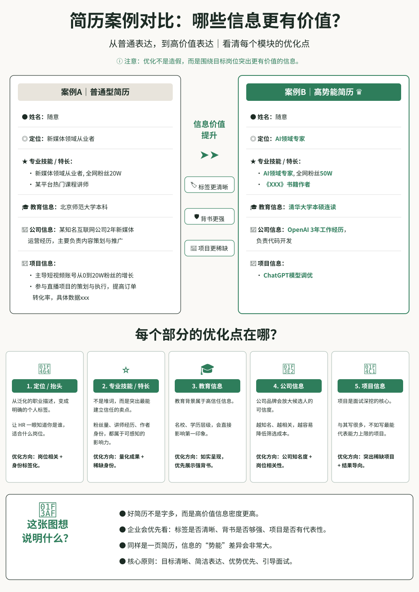

这里的点是：**简历不要刻意堆积信息，而是要突出重点信息**，有时候字多是不自信的表现。

#### 五大建议

具体到简历编写，可以有五个建议：

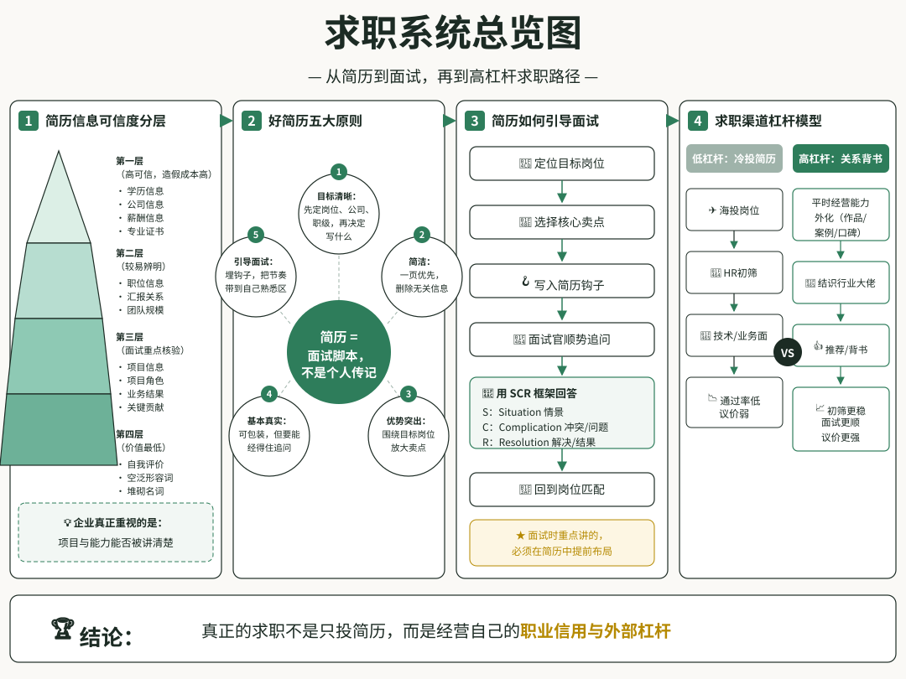

***1.目标清晰***

所谓目标清晰，就是你要想清楚你到底想要一个什么样的岗位；

这里需要结合你实际的专业能力、行业知识、过往履历综合分析；

举个例子，如果你是一个程序员，想转型做管理，那么简历内容就应该突出**团队管理与项目管理**。

***2.简洁原则***

所谓简洁原则，就是一页能干完的简历，别搞二页，越是精华越好；

不是必须的内容、对达成目标没帮助的内容，全部去掉，少造成干扰信息。

***3.优势原则***

简洁不是随意，字少就更需要突出重点、放大优势；

围绕目标写优势，比如找的是个文案编辑类工作，就突出自己自己公众号玩得溜，帮助某某多少时间涨粉多少，这些都是很好的逻辑链。

***4. 基本真实***

然后，简历**可以适度包装，但别太夸张**；

1. 参与某项目改成负责人；
2. 管理 5个人改成 50 人；
3. 参与过 Leader 处理过某紧急事故，非要说成是自己在处理；
4. ...

这些都可能风险点，碰到严格的面试官容易露馅，需要提前准备清楚。

***5. 引导面试***

简历服务于最终面试，是面试这个整体的一部分。

所以，**你面试时候要讲的，就是你简历里面重点突出的**。

举个例子，你如果面的是一个经理岗位，简历里面完全可以写一个失败项目，比如这样：

> 带领8个小伙伴连续加班4周完成XX项目，最后因个人项目管理经验不足，导致项目出现重大延期风险。
>
> 最后在总监跨级协助下，最终将项目成功推上线，在过程中深刻了解了项目管理的重要性，并积累了大量经验。

因为你在简历有这么一笔，人家一定会好奇、就会问，那么面试节奏就会到你手上，你自然更有机会讲好这次故事。

在表达方面这里有个技巧：**SCR 框架**，大家可以参考：

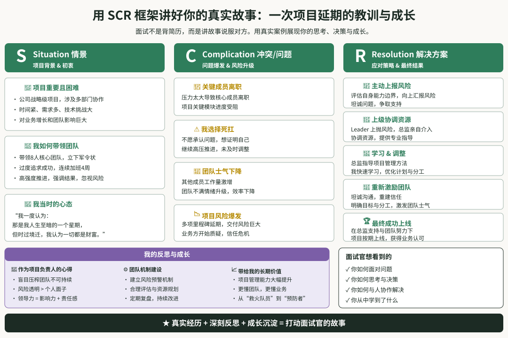

最后总结一下，简历作为一块敲门砖，做成这个样子基本够用了。

但这里大家需要回答一个问题：**简历重要吗？**

## 简历重要吗？

简历重要但没那么重要，它只是你职业道路上的一个小环节。

就我这些年招聘的经历来说，我们其实是不太关注简历的。如上所述，里面的**干扰信息、包装信息**太多了，我们其实只想要几个关键项目和能力，然后在面试时候好展开。

> 这里的意思是：企业视角来说关注的是能力，而能力的证据链是相关项目，所以（你做过的）项目列表是最关键的

这里的意思是，**与其过分在意简历的每一个字眼，不如更多地专注于提升自己的实际能力。**如果想找到一份好的工作，在平时就要多在专业和项目上花功夫。

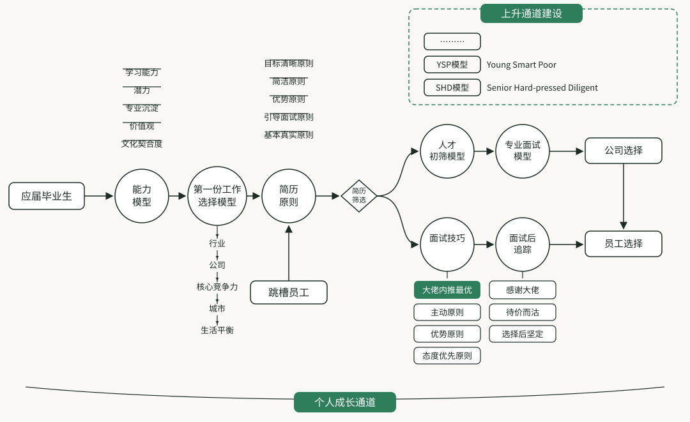

其次，在你平时的工作里面一定要去结识一些有经验的人，因为：

1. 第一，他们手中经常会出现一些岗位信息；
2. 第二，只要是熟人推荐的简历，那么初筛通过率会高很多；
3. 第三，如果能够得到可靠背书，那么面试通过率至少会提升一些；

这种背书本身是具有**品牌效应**的，别人也许会帮你推个简历，但不会随意为人背书，因为背书的人有问题是一件非常**影响信用的事情**。

至于，如何获得别人的认可，就是大家需要思考学习的了。

## 如何面试

面试技巧的话，整体来说回归三个原则：

1. 主动原则；
2. 优势优先原则；
3. 态度优先原则；

所谓主动就是引导话题，这个伏笔应该在简历阶段就埋下**引子**，这里具体要求是：**掌握主动权**：**需要有 4/5 的时间是你在做表达**。

这里的关键点是：**你要引导面试官的问题**。

关于你主动回答这件事，多数面试官是个无所谓的状态，因为面试本来就应该面试者多说，他需要倾听去了解你。

但要注意第二个点：**主动并不意味着急躁**，你依旧需要回答面试官合理的质疑，而不是回避。

所谓优势优先，就是要将项目过程中你的专业能力、管理能力、行业知识甚至人脉关系全部体现出来。

所以，你需要预判面试官可能质疑的点，将他的质疑变成你的完美回答。

至于如何预判，这点比较简单，**找有经验的人对练，模拟面试就好，或者在去心仪公司面试前，先找几家公司面试**。

态度优先原则的话，主打一个稳定抗压，真诚一点就好。

方法论方面多往：**SCR 框架**靠，其次**述职汇报**时候用的案例，也可以用于面试。

基本心法没问题，就要进入实际面试了，实际面试考察的是硬实力，这里又要分为两块：**通用能力与专业能力**。

## 通用能力模型

面试就是去评价一个人，一旦涉及评价，就会有方法论，最终的面试内容都**大同小异**。

我一直用的都是五维模型及Leader的五件事，这里对一线经理、总监、高管会有不一样的要求：

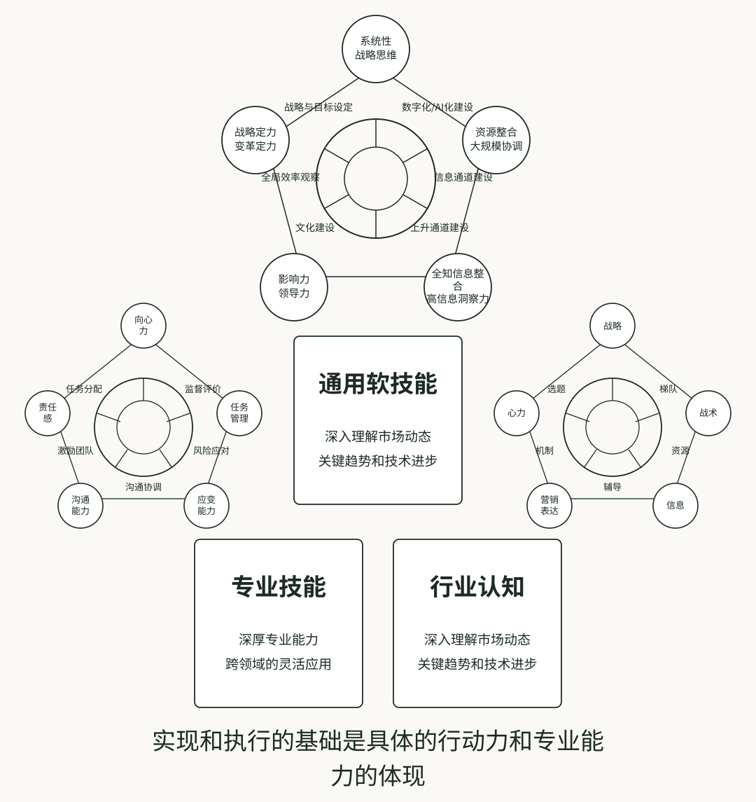

所以，你如果面试的是：

1. 一线员工，重点突出专业能力；
2. 一线经理，重点突出项目管理能力；
3. 总监，重点突出管理和机制推进能力；
4. 高管，突出品牌与业务理解及创新能力；

**要注意，专业能力是及格分，必须优先达到。**

然后，我使用的面试结构是这样的：

1. 请求职者自我介绍。考察表达能力；
2. 你处理过**最难的三件事**是什么，再来一次会如何。综合考察，重点聊天部分；
3. 工作中，你最讨厌的一个人。观察人际交往；
4. 工作中，你最认可的一个人。观察短期志向；
5. 你的待遇期待。考察ROI；
6. 你期望自己在新团队是什么样的角色。双方预期拉齐；
7. 你为什么离职。考察持之以恒和忠诚度；
8. 你未来两年的工作规划是什么。考察忠诚度和潜力；

我会优先从案例看是不是战略级人才，是否具备**独立思考**能力，这里的核心是选题，是如何帮助团队找到接下来要以什么为目标，并且说清楚为什么是这个目标。

交流过程中，一旦碰到以下信息，我会进一步深挖：

1. 是否作为产品一号位完成了项目，项目的规模是什么，做到了什么程度，有没有数据佐证；
2. 是否有非常规方式获取资源的案例，在什么难度下，获取了什么样的资源，如果是部门负责人，怎么做预算的，如何做资源分配的，底层逻辑是什么；
3. 是否有管理经验，怎么做的梯队建设，案例是什么；
4. 如何做人才辅导，项目辅导，下面同学遇到问题怎么处理的，是补位还是漠不关心，怎么看待补位的；
5. ...

重要内容都是围绕**最难三件事**展开，如果你自己有预期有节奏，我就跟着你的节奏走；如果你没节奏，那么作为面试官我就带节奏。

但是对于中高阶人才，如果没有带节奏的意识，那是态度问题还是平时不总结或者表达不佳？相信我，无论什么原因，都不是一个好的开始...

## AI 能力模型

前面说的是通用能力模型，接下来就是专业能力的探讨了，而因为我们做的是 AI 板块，所以聚焦方向是 AI 相关岗位。

这里值得特别说明的是：**现阶段无论是 AI 产品经理、还是 Agent 工程师，都算新兴岗位，所以很多企业并不知道要什么人、也对专业能力毫无认知**；

造成的结果就是岗位 JD 在乱写，比如：**熟悉大模型、熟悉 RAG/Agent/ Workflow**，更搞笑的就是不专业的筛选：

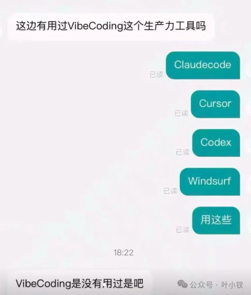

所以，站在对双方负责的角度，不建议完全去迎合企业，大家找工作可以很急，但进去后发现岗位预期不匹配就麻烦了...

其次，很多同学喜欢在简历里面堆专业名词：

```
Prompt 解决什么问题；  
Workflow 解决什么问题；  
RAG 解决什么问题；  
......
```

我更习惯将 AI 从底层逻辑分为六层：

```
第一层：AI 项目认知框架；  
第二层：Prompt/Workflow；  
第三层：RAG/Context Engineering；  
第四层：AI Coding；  
第五层：Agent；  
第六层：Agent RunTime；
```

只要你心中有这套架构，就只需要刻意训练了，训练的内容是：

> **让面试官的所有问题，全部回归这套框架**

这里大家可能有点懵，所谓回归框架是什么意思？

比如面试官问你：**熟悉 RAG 吗？**

你不要上来就背：**RAG 是 Retrieval-Augmented Generation，先检索再生成，流程是切分、向量化、召回、生成**...

更好的回答是先把问题放回框架：

1. 理解 RAG 解决的是模型使用外部知识的问题，它在 AI 应用工程里属于知识增强和上下文组织的一部分；
2. 如果只是简单知识库问答 RAG，涉及内容可能就是文档处理、向量召回、答案生成；
3. 但如果进入生产环境，就要进一步考虑文档质量、分块策略、查询改写、混合召回、rerank、低置信度处理、评测集和数据回流。

这里大家应该有感觉了：**面试官问的是一个点，你回答的是一条线，这就叫带节奏、这就叫回归框架**。

......

综上，大家应该能够深刻理解这种**专业知识地图**的重要性了，要注意的是他不仅对 AI 知识有用，其他模块也有用：

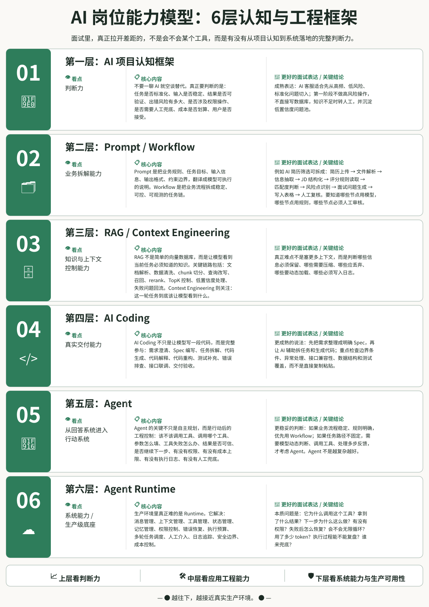

好了，再概述了通用能力专业能力后，我们可能需要简单升维，触及一点本质了：

## 面试的本质

面试的本质是梯队建设，一般来说是团队某个位置缺人，就要招人。

> 特殊情况：完全新建团队，是面试者最大的福音，赶紧去！

但这里马上就有一个值得玩味的问题，什么位置缺人，缺什么人？

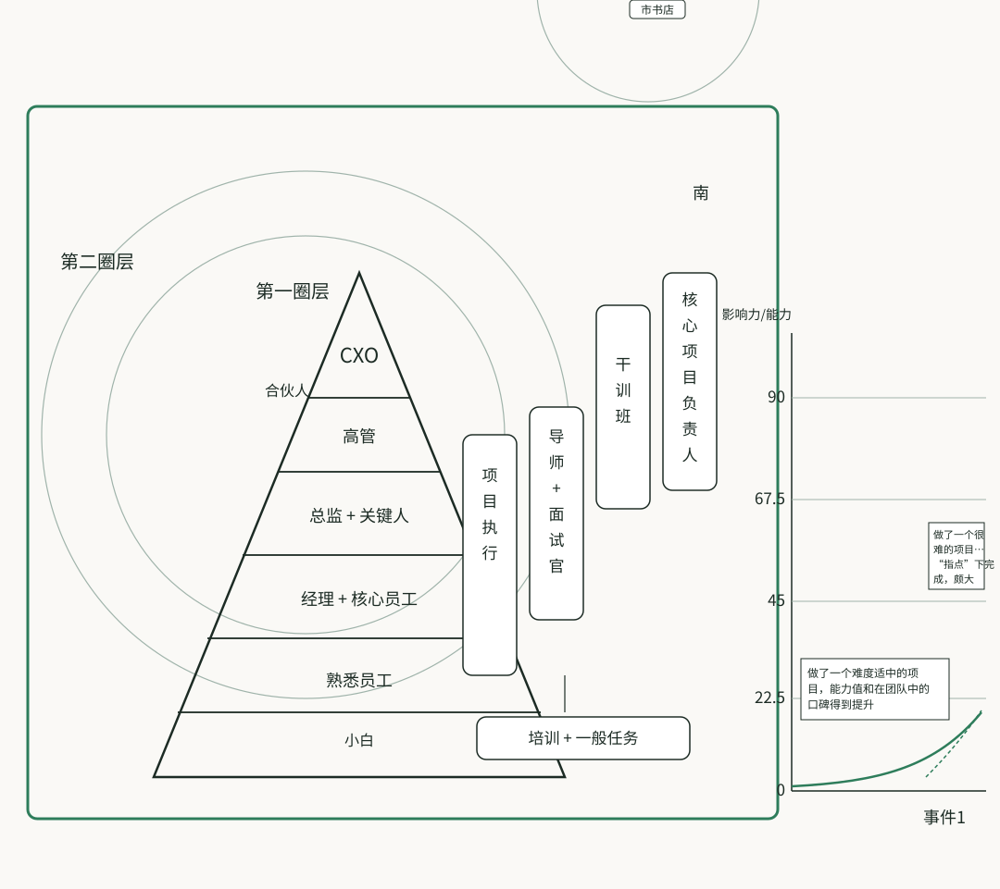

就个人经历来说，缺三种人：

1. 第一梯队干部；
2. 第二梯队干部；
3. 第三梯队干活的；

#### 第一圈层

首先说第一梯队，这批人除了能力本身没有大问题以外，对**忠诚度**要求极高。

他们会从事团队中最核心的工作，这种人很难直接招；如果将资源给到了不合适的人手里，极可能能力越大，伤害越大；

除非信任基础很好，否则一般不会直接外招。

#### 第二圈层

其次是第二梯队，从这个部分开始，一定会外招，而且必须保证每年有一定比例的进出：问渠那得清如许，为有源头活水来。

第一梯队一般有多年战斗情谊，但能力未必最优，因为私交甚至可能会有所放纵，团队需要在两个方面帮助他们：

1. 新的能力输入，可能是管理理念，可能是技术能力，这些是外招第二梯队的主要目的；
2. 放进一些鲶鱼，引导团队做良性竞争，毕竟作为 **Leader 要让自己有的选**；

#### 第三圈层

然后就是一线同学招聘了，对于这些同学，如果职级不是太高，都是将权限下放给其他Leader就好。

综上，团队第一梯队很少外招，第二梯队会有不小的比例外招，招进来也就是我们俗称的中层干部了，团队对他们的期待有三：

1. 为团队带来新的能力，可以是拉高上限，也可以是让团队能力更加全面；
2. 增加团队良性竞争氛围，让有些想躺平的同学不敢躺；
3. 外招中层还有个重要工作就是完成本质那部分工作；

小公司第二梯队一般为市面上的P7、P8，大公司职级往上挪一两级即可。

可以看出，从招聘目的来说，第二梯队这批同学日子就是**不好过，需要承担更高压力**...

而基层员工是一个萝卜一个坑，反而没什么好说的，下面是不同梯队员工掌握的资源和权限：

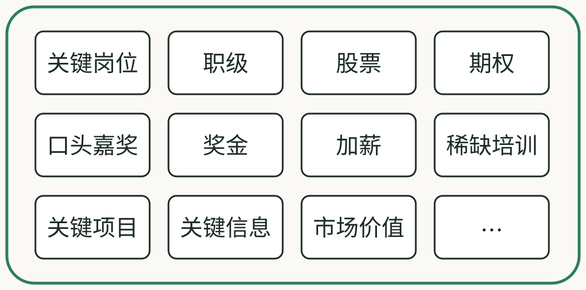

好了，至此整个面试系统应该已经比较完整了：

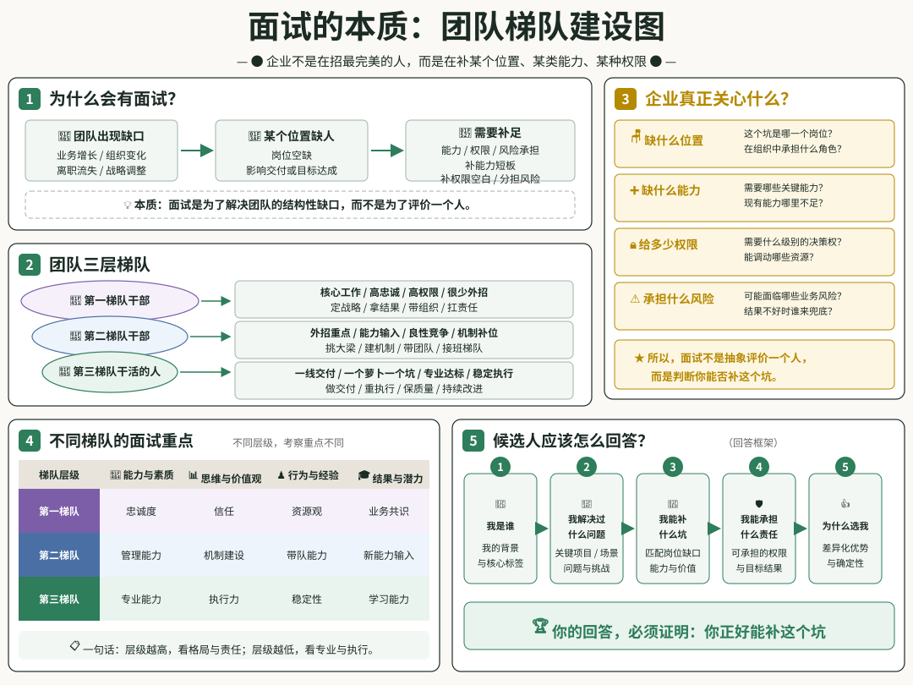

## 结语

好了，该说的**干货**和**黑话**都摆在这了。

最后还是回到一句话：**找工作这件事，表面看是简历和面试，底层其实是能不能让别人相信你。**

我们今天东拉西扯，从头到尾其实也就只讲了一件事：**用管理的思维，经营你自己。**

**写简历，是在梳理你的价值卖点；**

**面试，是证明你确实有那个价值卖点；**

**建立AI知识框架，是让这件事真实的在平时工作中发生；**

到这大家应该也有感觉了：今天也不完全是教大家写简历做面试，其实在描述的是一套**求职系统**。

所以，如果你已经读到这里，不妨用上面的**六层AI框架**，对照自己的项目经历重新拆解一遍，需要关注的核心是：

> **能不能用三句话说清楚，自己的最大价值是什么、证据链是什么、然后如何去表达？**

如果不行，那就多练，面试这东西本质上也需要反复训练和复盘。

今天的内容就到这了，希望对大家有用！
